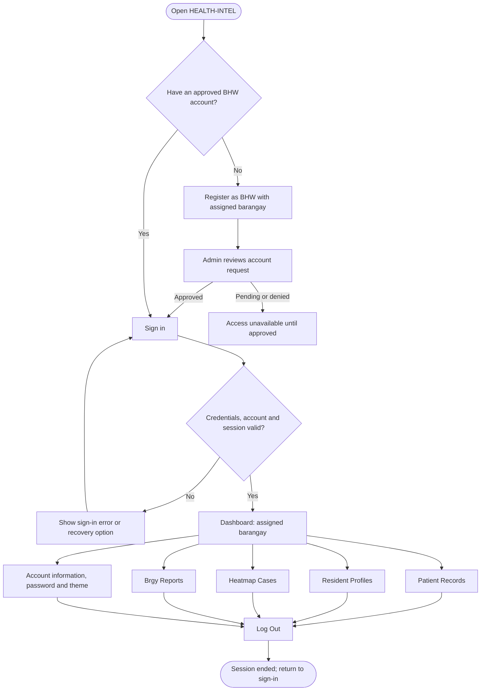
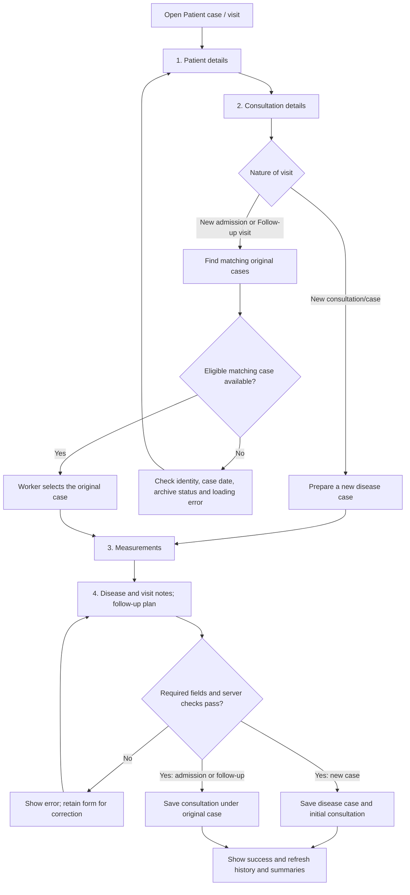
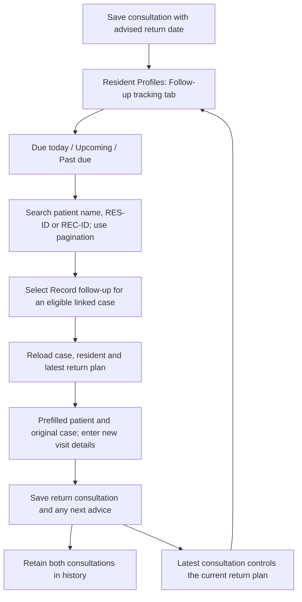
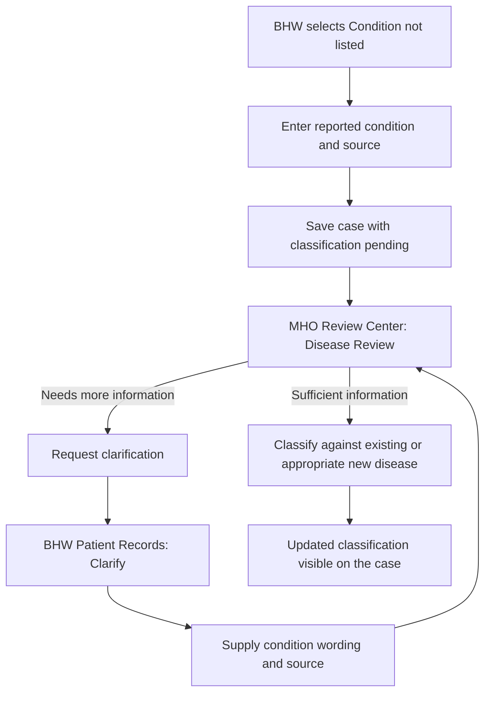
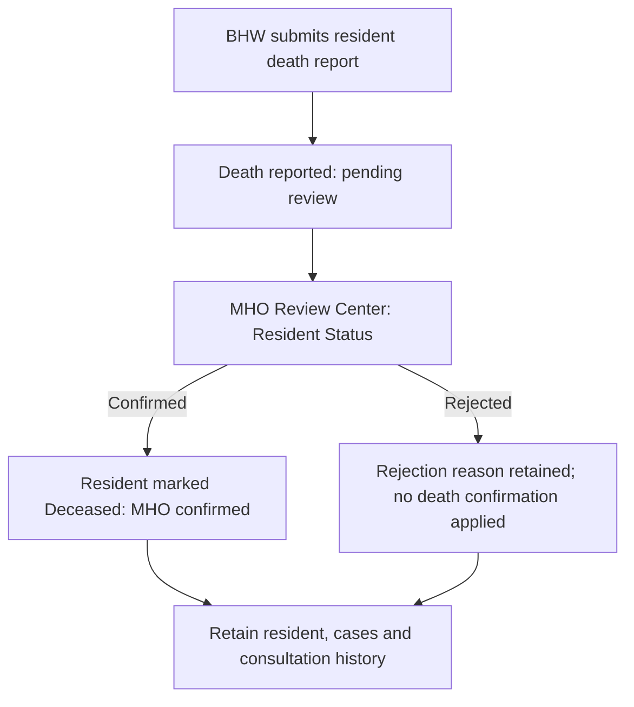

# HEALTH-INTEL — Complete BHW workflow

Current local implementation, reviewed October 18, 2026. Includes the recent consultation, resident-history, follow-up, reporting and heatmap changes. This is a workflow reference based on the code; writing it does not constitute a fresh live test or deployment.

## 1. Overall navigation

The five sidebar pages are independent navigation choices, not a sequence that must be completed. All protected BHW data actions are restricted to the assigned barangay; typing another barangay or record ID does not grant access.

Existing approved beta accounts can start at sign-in. They do not need to register again.

## 2. Dashboard

Sign in → load assigned-barangay context → display:

- Recorded Cases, Active Cases, Cleared Cases and High Risk totals.
- Case Status & Recorded Severity breakdown: Cleared, Mild, Monitored and High Risk.
- Disease Trend chart.

Saving or maintaining a case refreshes relevant displays. A disease-case count is not a unique-resident count or a consultation count.

## 3. Patient Records

Open Patient Records → load current, non-archived cases → search by patient name → use pagination → select an action:

| Action | Flow |
| --- | --- |
| Add case / visit | Open the four-step form described below. |
| Profile | Open the linked resident dossier, including cases and consultations. |
| Case details | For an older unlinked case, show the recorded details and explain that its resident identity link needs review. |
| Update Status | Choose Active, Cleared or Deceased; enter notes if needed; validate and save. Notes are appended to existing case remarks. |
| Clarify | Appears when MHO requests disease clarification. Enter the reported condition and source, then resubmit for MHO review. |
| Correct | Review case date, recorded disease and recorded severity; give a correction reason; validate and save with audit history. Historical identity limitations may lock date/disease changes. |
| Archive | Confirm archiving; retain the case and history, remove it from the ordinary non-archived view. |
| View Archived → Restore | Search/view archived cases, confirm Restore, then return the case to the ordinary list. |

Loading, failed loading and empty results have distinct feedback. A failed load offers Retry. A rejected save displays the error and does not show a false success message.

**Update Status is not a replacement for recording a consultation.** To retain visit date, measurements and follow-up advice, use the case/visit form.

## 4. Four-step patient case / visit form

Back and Continue move between steps. Save is completed only after validation. Cancel closes the form without saving the unsaved entry.

### Step 1 — Patient

| Field | Current behavior |
| --- | --- |
| Family name | Required and placed before First name. |
| First name | Required. |
| Suffix | Compact selector: None, Jr., Sr. and Roman-numeral choices. None can be selected again after an accidental choice. |
| Birthdate | Required numeric MM/DD/YYYY entry. Slashes are inserted automatically; letters do not erase the entered date. Calendar-date handling avoids shifting the birthday through UTC. |
| Age on consultation date | Calculated automatically, including age 0 for infants. Recalculates when the consultation date changes. |
| Purok / zone | Required. The assigned barangay is shown and enforced. |

Matching considers recorded identity, including name, suffix and birthdate within the barangay. Different birthdays are not silently treated as the same person. Address whitespace is normalized in resident matching to avoid spacing-only duplicates; this does not automatically merge old uncertain profiles.

### Step 2 — Consultation

| Field | Choices / behavior |
| --- | --- |
| Mode of transaction | Required: Walk-in, Visited or Referral. |
| Referral details | Referral reveals Referred by (optional) and Reason for referral (required). |
| Nature of visit | Required: New consultation/case, New admission or Follow-up visit. |
| Consultation date | Required; defaults to today in the Philippines. Future consultation dates are not allowed. |
| Consultation time | Optional: Hour, Minute and AM/PM. Fill all three correctly or leave all three blank. |
| Existing disease case | Required for admission/follow-up; not used to link a new disease case. |

**Mode and nature are different:** Walk-in explains how the encounter occurred; Follow-up visit explains why it belongs to an existing case. A return visit can therefore be both Walk-in and Follow-up visit.

### Selecting an original case

1. Enter the patient's matching first name, family name, suffix and birthdate.
2. Choose New admission or Follow-up visit.
3. The form finds eligible cases in the assigned barangay.
4. Each option shows the disease/condition and status, Case ID (REC-number), original case date and last consultation date.
5. If multiple cases match, compare those details and select the correct disease episode. The system does not guess.
6. The selection summary confirms which case will receive the visit.

A consultation cannot predate its original case. Archived cases are unavailable. Confirmed deceased residents have additional historical-date restrictions; the shortcut does not offer normal new return entry for them. If no eligible match is available, investigate the details rather than create another case solely to bypass the message.

### Step 3 — Measurements

All four are required for the current form:

- Blood pressure in mmHg, using systolic/diastolic format.
- Temperature in degrees Celsius.
- Height in centimetres.
- Weight in kilograms.

The form validates values. Measurements do not automatically diagnose a disease or assign severity.

### Step 4 — Disease, severity, notes and return advice

For a **new case**:

- Choose the reported disease/condition from the searchable dropdown.
- The opening suggestions show up to 10 ranked/available diseases; typing searches the catalog. Show all opens the wider list.
- If absent, choose Condition not listed, supply the exact reported wording and source/reference, and submit it for MHO review.
- Select recorded severity: Mild, Monitored or High Risk.
- Enter symptoms/remarks if available.

For an **admission or follow-up**:

- The original disease case is retained; selecting another disease is not part of the linked-visit flow.
- Enter fresh measurements, visit severity and notes.
- Visit severity is stored for that visit; it does not silently replace the original case severity.

For either path, record **Next follow-up date** and **Follow-up instructions** when advised by the attending health professional. The date must be on or after the consultation date. Leave it blank if no return date was advised. This records advice; it does not book an appointment or send patient reminders.

### What saving creates

| Nature | Database relationship | Count behavior |
| --- | --- | --- |
| New consultation/case | New disease case and initial consultation, linked to the matched/new resident as validated. | Adds one disease case and one consultation. |
| New admission | New admission consultation linked to the selected original case. | Adds one consultation; no extra disease case. |
| Follow-up visit | New follow-up consultation linked to the selected original case. | Adds one consultation; no extra disease case. |

Example: one resident with one influenza case, an admission and two follow-ups has **1 resident, 1 disease case and 4 consultations** when the initial consultation is recorded.

## 5. Resident Profiles and complete history

Resident Profiles → search → filter All residents / Living / Deceased · confirmed → use pagination → View Medical Dossier.

The dossier shows:

- Resident name, suffix where recorded, location and age; confirmed deceased residents use the available age-at-death information.
- Resident status and pending/confirmed death-report information.
- Total cases, Active cases, High Risk cases and Consultations.
- Disease case history: Case ID, reported condition, remarks and status.
- View visits and consultation history: visit type, date/time, transaction mode, measurements, visit severity, notes and recorded follow-up advice.
- Eligible case actions to record a follow-up/admission.

The return shortcut reloads the linked case, checks resident identity, fills and locks patient details, preselects the original case and opens the consultation stage. The worker records the new encounter details rather than retyping the patient.

Older cases may have disease history without consultation rows. An empty consultation history does not necessarily mean the disease case is missing.

## 6. Follow-up tracking — new return-plan workflow

- Due-date buckets use the Philippine calendar date.
- The latest consultation is selected by consultation date; saved visit ID breaks same-day ties. An older backdated visit does not reactivate an earlier plan.
- A latest consultation without a return date no longer supplies the earlier visit's pending return plan.
- Archived cases, cases marked Deceased and confirmed deceased residents are excluded from this tracking list.
- A missing or inconsistent resident link can block the return shortcut until reviewed.
- Past due means no later consultation is recorded. It does not establish that the patient missed an appointment.

## 7. Unlisted disease and clarification loop

Ordinary cases using a listed disease do not all wait for MHO approval. Pending conditions retain their wording and review status rather than receiving a guessed disease label.

## 8. Case status versus deceased-resident reporting

These are distinct workflows.

**Case status:** Patient Records → Update Status → Active / Cleared / Deceased → save notes and status. This action alone is not MHO confirmation that the resident is deceased, and does not establish cause of death.

**Resident death report:** Resident Profiles → dossier → Report deceased → enter reported date if known, source/reference (required) and optional note → Submit for MHO review.

Do not invent an unknown death date. A pending report does not itself confirm death or change every disease case. Confirmed residents remain searchable using the deceased filter; automatic deletion or transfer is not part of this flow.

## 9. Heatmap Cases — updated visual interpretation

Open Heatmap Cases → view recorded geographic summaries → select a marker → read the summary popup → optionally enter fullscreen → exit fullscreen or press Escape.

- Updated donut segments show the proportion of Mild, Monitored, High Risk and any unclassified active cases.
- The centre displays the active-case count; count badges keep Monitored/High Risk cases visible.
- Example: 18 Mild + 1 Monitored produces a mostly green marker with a small orange segment, rather than a completely orange marker.
- The popup presents severity totals, recorded conditions, an explanation of the marker and refresh information.
- Marker summaries are aggregate displays, not individual patient locations, outbreak boundaries or validated outbreak-risk scores.
- BHW scope remains their assigned barangay.

## 10. Brgy Reports

| Report | BHW flow |
| --- | --- |
| Today's barangay report | Open Brgy Reports → Download today's PDF. The server selects today using Philippine time and enforces the assigned barangay. New disease cases and consultations are counted separately. |
| Monthly report | Select month and year → Generate monthly PDF. |
| Surveillance report | Use the selected month/year and optionally one purok → Generate surveillance PDF. |

Reports describe the selected scope. An empty period is reported as no matching cases rather than silently using another period. Academic sample output is not official reporting certification. A download response does not independently prove the user saved the file successfully.

## 11. Account, appearance, mobile use and logout

- Account menu → view System ID/role → supply current and new password → update → sign in again.
- Forgot password on the sign-in flow → request recovery → complete the reset using the provided recovery link when email is configured.
- Theme button → switch light/dark mode; the preference is saved.
- Responsive navigation supports small screens; forms use four steps, clear labels and validation feedback. Resident and patient lists use pagination.
- Log Out revokes the current session and returns to sign-in. Account suspension and password/access changes also invalidate affected existing sessions.

## 12. Recent changes included in this flow

1. Family name before first name, compact suffix and a selectable None option.
2. Assisted numeric birthdate, automatic separators and calendar-date-safe matching.
3. Automatic age on the consultation date, including zero for infants.
4. Four-step consultation form with Walk-in/Visited/Referral, referral source/reason, consultation time with AM/PM and explicit visit nature.
5. Required blood pressure, temperature, height and weight.
6. Searchable original-case options with disease, status, case ID, original date and latest consultation; eligibility checks prevent date-incompatible choices.
7. Searchable disease catalog with top-10 suggestions and an unlisted-condition review path.
8. Linked admissions/follow-ups; fresh visit details without duplicating the original disease case.
9. Prefilled return-visit shortcut from resident history and follow-up tracking.
10. Next follow-up date/instructions and Due today/Upcoming/Past due tracking.
11. Full consultation history alongside disease history, separate case and visit totals, and paginated resident profiles.
12. Separate deceased-resident reporting, MHO confirmation and retained history.
13. Fullscreen map, clearer popup and proportional severity markers.
14. Today report using Philippine time, plus monthly and surveillance exports.
15. Loading/Retry/error feedback and protection against false save-success messages.
16. Barangay scope enforcement, revoked sessions on logout/access changes and prevention of stale approvals restoring suspended accounts.

## Source references

Reviewed `bhw.html`; `assets/js/bhw/`; shared `patient-visits.js`, `encoding-controls.js`, `followup-tracking.js`, `resident-vital.js`, `case-corrections.js`; and the backend access rules, case routes and corresponding case/follow-up services. This document describes implemented behavior and does not claim every scenario was freshly exercised on Azure during this documentation task.
