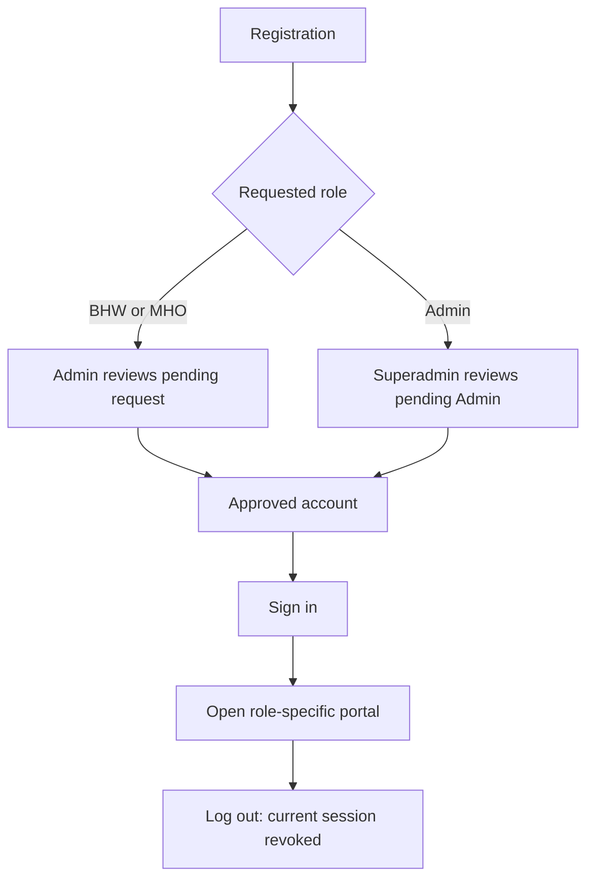
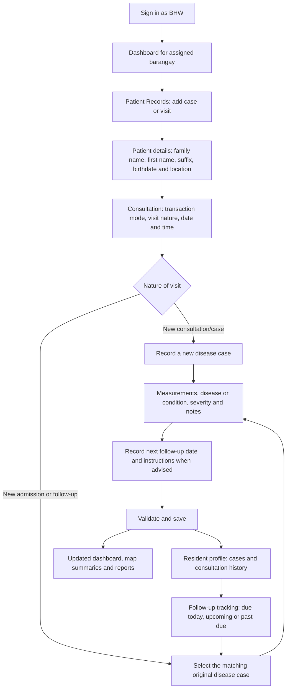
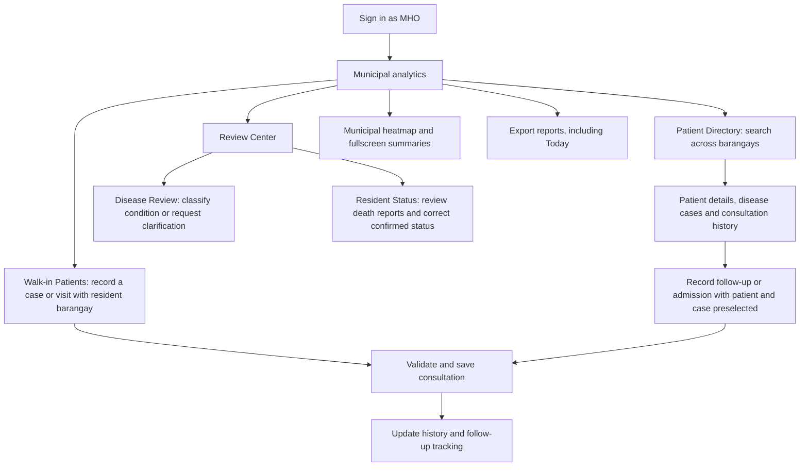
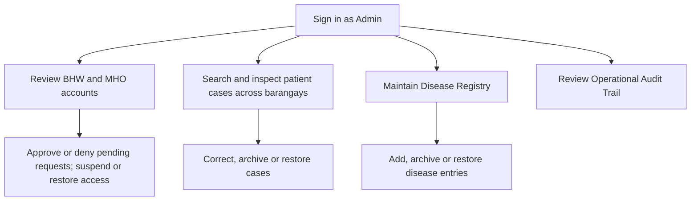
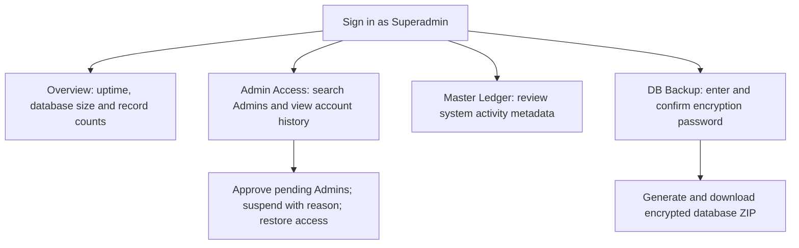

# HEALTH-INTEL current role flows

Reviewed against the current local portal screens, access-control rules and route handlers on October 18, 2026. This documents implemented behavior; it is not a new deployment or a new end-to-end test.

## Access and account approval

- Pending, denied and suspended accounts cannot access protected workflows.
- Admin can approve or deny pending BHW/MHO requests, undo a denial, suspend approved BHW/MHO accounts and restore suspended access.
- Superadmin's Admin Access screen approves pending Admins, suspends active Admins with a reason, restores suspended Admins and shows account history.
- An old approval request cannot restore a suspended account. Restore Access is a separate action. Access changes invalidate existing sessions; restoration requires a fresh sign-in.

## BHW — barangay recording and follow-up

Menu: **Dashboard → Patient Records → Resident Profiles → Heatmap Cases → Brgy Reports**. These are navigation choices, not mandatory sequential steps.

- Walk-in, Visited and Referral describe how the encounter occurred. Referral details are captured where relevant.
- Admissions and follow-ups add consultations to the selected case; they do not create another disease case.
- Case selection uses patient identity and eligible case dates. The worker selects the correct episode using disease, case ID, status, original date and last consultation.
- Disease selection is searchable, with a top-10 suggestion list. An unlisted condition preserves its wording and enters MHO disease review rather than receiving a guessed classification.
- BHW can view case details and visits, update case status, correct records, and archive or restore cases within their barangay.
- Resident Profiles includes medical history and follow-up tracking. The latest consultation's return plan replaces the earlier plan. Past due means no later consultation is recorded, not proof that an appointment was missed.
- BHW reports a resident as deceased for MHO review. Reporting is distinct from confirming resident death; history remains available.
- Reports include Today. The fullscreen map shows proportions of recorded case severity, not a validated outbreak-risk rating.

## MHO — municipal oversight and consultation recording

Menu: **Mun. Analytics → Walk-in Patients → Patient Directory → Predictions → Review Center → Heatmap Cases → Export Reports**.

- MHO chooses the patient's resident barangay when recording a municipal encounter.
- Patient Directory supports patient lookup, full recorded history and follow-up tracking across barangays.
- Disease Review can link a reported condition to an existing disease, register an appropriate new condition, or request clarification from BHW. This is not an approval gate for every ordinary consultation.
- Resident Status handles death-report review and status correction without deleting the resident's history.
- Exports include Today, FHSIS/PIDSR sample reports and confirmed deceased residents. Sample exports are not official submission certification.
- Predictions is an existing demonstration feature with validation pending. Do not present it as a clinically validated forecast or an automatic diagnosis/outbreak decision.

## Admin — personnel and record maintenance

Menu: **User Management → Patient Records → Disease Registry → Operational Audit Trail**.

Admin maintains access and data quality. The Admin portal is not the consultation-entry workflow and does not approve Admin accounts. Archiving retains records rather than deleting their histories.

## Superadmin — Admin access, system monitoring and recovery

Menu: **Overview → Admin Access → Master Ledger → DB Backup**.

Superadmin's current portal does not offer routine patient consultation entry, a database-restore button or a factory-reset button. Azure VM resizing and the scheduled encrypted backup to the PC are separate operational tasks outside these portal flows.

## How the roles connect

| Connection | Current flow |
| --- | --- |
| Account access | Superadmin manages Admin access; Admin manages BHW/MHO access. |
| Recording | BHW records barangay encounters; MHO records municipal encounters linked to the resident barangay. |
| Clinical history | One resident can have multiple disease cases; each case can have multiple consultations. A follow-up adds a visit to its original case. |
| Disease clarification | BHW reports an unlisted condition → MHO classifies it or requests clarification → BHW supplies clarification if needed. |
| Deceased status | BHW reports resident death → MHO reviews and confirms or rejects the report → history remains retained. |
| Maintenance | Admin maintains registry and case records; Superadmin monitors technical activity and creates encrypted backups. |

Identity differences, including different birthdays, are not permission to merge residents automatically. Existing uncertain duplicate identities must be confirmed before combining histories.

Source references: `bhw.html`, `mho.html`, `admin.html`, `superadmin.html`, `server/middleware/access-control.js`, `server/routes/`, `server/services/account-status.js`, `assets/js/shared/followup-tracking.js` and portal scripts.
