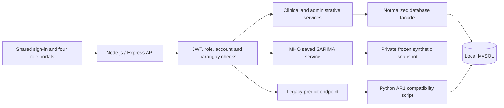

> 2026-11-16T23:50:37.783435+08:00 - CODEX-1 completed CLEAR-OLDER-CASES-20261116 local data maintenance after explicit owner clarification Mark older cases Cleared; keep staff accounts. Six non-archived Active cases recorded before 2026-11-01 changed to Cleared: Caliban 1, Cansilayan 1, Minoyan 1, Salvacion 1, Sta. Rosa 2; Alegria/Blumentritt 0. All three current-month active cases preserved (Blumentritt 2, Cansilayan 1). One transaction with per-case Status Updated audit metadata recording owner-requested cleanup rather than a clinical assessment. In-transaction fingerprints verified staff accounts, resident profiles, consultation rows, case row count and all other case fields unchanged except target status/update timestamp. Independent post-commit check confirmed zero older active cases and six corresponding audit entries. No deletions, archive changes, recurring month-end automation, source/runtime/model changes or Azure updates. External aggregate-only evidence and maintenance script in clear-older-cases-20261116. Local data operation is not part of the Azure runtime copy list.

> 2026-11-16T23:41:44.453076+08:00 - CODEX-1 completed HEAT-COLORS-20261116 locally on main/e5946d4. MHO Heat View now uses the same assessed monthly activity totals/tone as Barangay Summary: 1-10 green #16a34a, 11-20 orange #d97706, 21+ red #dc2626. Replaced max-normalized active-case weights/additive Leaflet.heat interpolation with native Leaflet layerGroup/circleMarker soft fixed-category halos at supplied barangay centers; neighboring counts cannot add into a false higher band. No extra dependencies, case points or locations fabricated. Zero totals draw no halo; unavailable/invalid assessments are omitted explicitly. Legend shows fixed monthly ranges and location/risk limitations; class labels remain visible in Heat View. Existing dark basemap retained; native vectors redraw on update/resize and remove on returning to summary. BHW retains Summary-only mode. Twenty-seven focused heat/details/access/fullscreen checks passed, covering exact boundaries, relative-max independence, adjacent Mild halos, zero/missing state and switching/resize. Syntax/scoped diff checks passed; localhost served new script HTTP 200. Fresh signed-in visual QA not performed. No DB/backend/model/Azure changes or restart. Cache versions/deployment manifest updated.

> 2026-11-16T23:28:01.712970+08:00 - CODEX-1 completed ACTIVE-COUNT-LABEL-20261116 locally. Shared BHW/MHO map total now says Currently active case(s), with All recording dates on a second line, distinguishing it from the monthly marker count. Counting rules/data unchanged. Cache versions refreshed. Syntax and synthetic singular/plural/unchanged-total assertions passed. No DB, backend, model or Azure changes; no server restart required. Signed-in visual QA not rerun.

> 2026-11-16T23:24:30.777957+08:00 - CODEX-1 completed SUMMARY-ORDER-20261116 locally on main/e5946d4. User-requested order: Individual patient severity, disease breakdown, then Barangay case-activity classification. Shared BHW/MHO popup reordered, spacing adjusted, cache versions updated. Monthly counting, fixed ranges and patient data unchanged. Ten existing map-detail tests, rendered-order assertions, syntax and scoped diff checks passed. No server restart, DB/Azure/model changes. Signed-in visual check not rerun.

> 2026-11-16T23:19:53.446693+08:00 - CODEX-1 completed MONTHLY-MAP-BANDS-20261116 locally on main/e5946d4. Owner corrected case-volume counting basis to monthly. Map now counts current Philippine calendar month from day 1 through today, excludes future records, resets on local month rollover. Fixed combined-total ranges unchanged: zero neutral, 1-10 green Mild, 11-20 orange Monitored, 21+ red High Risk; these remain locally chosen case-volume bands, not official outbreak thresholds. Shared summary circle caption, popup, accessibility labels and both portals now say this month/month to date; no stale weekly wording in affected runtime files. 23 affected date/range/renderer/access tests passed including first-day inclusion, prior/future exclusion, year rollover and leap day. Four JS syntax and scoped diff checks passed. Actual read-only DB check returned seven barangays with November 1-16 window. Local loopback server restarted hidden PID 5244 retaining frontend/CMP preview settings. No DB writes/migration, dataset/model/Azure/tunnel changes. Signed-in visual QA not rerun for date/label correction. Future authorized deployment copies runtime files together and restarts application.

> 2026-11-16T23:05:44.616465+08:00 - CODEX-1 completed FIXED-MAP-BANDS-20261116 locally on main/e5946d4. Explicit owner ranges installed: 1-10 Mild green, 11-20 Monitored orange, 21+ High Risk red, zero neutral No recorded cases. Replaces prior mean/SD policy. Combined last-seven-day total shown at circle center now determines its color; each disease row uses the same ranges. History and individual severity do not change the bands. Existing Philippine dates, recording eligibility, BHW scope and separate active severity retained. Query window simplified to seven days. Popup and legends explain fixed ranges as local case-volume bands, not official outbreak thresholds. 41 focused map/calculation/access/fullscreen/heat tests passed, including 0/1/10/11/20/21/1000 and 8+8=16. Actual read-only local DB check returned all seven barangays; one case is Mild, zero cases neutral. Syntax/diff checks passed, localhost health/script 200. Hidden loopback server PID 18276 retains frontend and authorized CMP preview settings. No DB writes/migration, Azure/model/dataset/tunnel changes. Signed-in visual QA not rerun. Deployment requires these runtime files together and application restart.

> 2026-11-16T22:49:17.144728+08:00 - CODEX-1 completed LIVE-MAP-ACTIVITY-20261116 locally on main/e5946d4. User explicitly chose statistical case-activity bands for all ten study categories, labeled analytical rather than official outbreak risk. Live read-only map query counts new case records over the last seven Philippine calendar days against three preceding seven-day periods, including today; sample SD uses n-1. Mild is <= mean+1SD; Monitored > mean+1SD; High Risk > mean+2SD. Each category is calculated independently; strongest disease band sets the circle, with new/7d total at center. Zero baseline with new activity is Monitored with no estimated red cutoff; no current records is Mild recorded activity only. Pending/unlisted current cases withhold a misleading green overall assessment. Query preserves BHW canonical assignment, includes valid archived/cleared cases, uses reporting-exclusion decisions and excludes follow-up visit rows and generated forecast history. Pending disease classifications are not assigned to a category. Popup shows period, driver disease, current and previous counts, mean/SD, exact integer starts, reason and all ten bands; individual severity remains separate. These are exploratory bands from three periods, unadjusted for seasonality/population, and no-record days mean zero recorded cases rather than verified complete reporting. No official outbreak threshold or clinical interpretation claimed. 41 focused map/calculation/access/fullscreen/heat tests passed; after a disease-filter isolation fix, all 22 affected tests passed again. Syntax and scoped Git checks passed. Read-only actual local database query returned all seven barangays with ten assessments each. Isolated Chrome at 366px panel width showed a synthetic red activity signal with a separate Mild patient; DOM assessment/explanation checks true and no header clipping, screenshot inspected. Actual signed-in end-to-end map interaction not run. Local server restarted hidden on loopback PID 2112 with frontend and previously authorized CMP preview enabled; health/page 200, anonymous map API 401. Forecast CSV hash unchanged. No DB writes/migration, Azure deployment, model fitting or public tunnel. External evidence: live-map-activity-20261116. Supersedes the preceding Not assessed-only UI task.

> 2026-11-16T22:31:58.201178+08:00 — CODEX-1 completed MAP-CLASSIFICATION-20261116 UI separation locally on main/e5946d4. Shared BHW/MHO summary markers now use a single neutral ring and Not assessed label instead of proportional individual severity colors. Popup places Barangay surveillance classification above Individual patient severity, retaining aggregate totals, disease rows, unknown severity and refresh/accessibility. Legends describe the proposed Mild/Monitored/High Risk threshold meanings. IMPORTANT: no validated disease thresholds, surveillance reporting period or corresponding incident counts exist in the current map API. All classifications intentionally remain Not assessed; automatic green/amber/red classification is NOT implemented or activated. No numeric cutoffs fabricated, no DB/backend/data/model/Azure changes. Thirty-four focused map/detail/heat/access/fullscreen tests passed; three script syntax checks and scoped Git whitespace checks passed. Localhost served updated versioned script. Isolated synthetic Chrome DOM check reported no horizontal overflow and correct unavailable assessment; screenshot was clipped by the headless minimum-window-size fixture, so signed-in/mobile visual QA remains pending. Git inspection required escalation due sandbox worktree access; all pre-existing changes preserved. Follow-up: obtain applicable MHO-validated per-disease rules and reporting periods, connect incident counts, then implement and test threshold evaluation.

> 2026-11-16T21:32:05.3664684+08:00 — CODEX-1 completed BHW-MAP-VIEW locally. Restored BHW Map view navigation and lazy-loaded assigned-barangay case summaries. BHW summary mode omits Heat View and the optional Case Breakdown control, and loads no heat-view/heat-layer library. Existing marker details, severity legend, refresh and fullscreen controls are reused. Boundaries are restricted to names returned by the authorized case API. MHO default map modes are retained. Eighteen map/detail/access tests and three targeted portal/navigation tests passed; localhost served the new page. Signed-in visual QA pending. No database or Azure change.

> CMP-RELIABILITY-20261106 completed 2026-11-06T21:49:46+08:00, CODEX-1 / Ponytail. Separate fixed conditional-dispersion research:100 accepted fits/50 short-history ineligible rows, primary626/630 and October70/70; matched probability log loss0.9975→0.9393/RPS0.3250→0.3123.43 scopes improve,17 worsen,10 mixed. SARIMA means/point errors unchanged. Secondary626 targets duplicate primary, no independent confirmation. Original preview retained. Separate tested issue/score ledger for both probability policies and baselines; honest issued-during-month timing corrects incompatible pre-start/completed-cutoff promise.13 focused tests and2504 independent distribution/100 analytic gradient checks pass;3198 existing source/data files and original evidence unchanged. No app/DB/Azure integration. Actual new-outcome validation pending. See [reliability report](CMP_RELIABILITY_20261106.md); external cmp-reliability-20261106 contains policy, evidence and future guide. Ownership released.

> Local UI update 2026-11-07T16:22:46+08:00: all4roles share the compact blue/green account/password dialog. Superadmin overview uses a masked ID and role greeting; full ID remains in Profile. Browser visual verification pending; Azure unchanged. See [account dialog report](ACCOUNT_DIALOG_20261107.md).

> CMP-LOCAL-PREVIEW-20261106 completed 2026-11-06T21:01:29+08:00, CODEX-1 / Ponytail. Separate loopback preview on8770; all70 real browser selections match saved SARIMA/CMP and selected metrics. Nine Node/four Python tests pass;70 October and1599 historical probability outputs independently checked; four missing primary outputs retained. Desktop/laptop/tablet/mobile and light/dark/keyboard checked. 3198 existing runtime/data/source files unchanged; no DB/Azure/model fitting or installation. New-outcome probability validation remains outstanding. External cmp-local-preview-20261106 evidence; see [preview report](CMP_LOCAL_PREVIEW_20261106.md). Ownership released.

> Current LOCAL catalog — 5 November 2026: exactly the ten study diseases remain active. Three extra catalog entries were recoverably archived; patient histories and descriptive totals retain their original records. Active catalog supplies MHO/Admin/encoding/correction choices, with current historical correction labels and unlisted MHO review preserved. Azure and frozen prediction data are unchanged. Monthly reporting/update/review/publication is now implemented locally, with a separate operational source; see [catalog cleanup](LOCAL_TOP10_CATALOG_20261105.md) and [monthly implementation guide](MONTHLY_PREDICTIONS_20261105.md). Older proposal-only monthly notes below are superseded.

> AZURE-SESSION-20261105 COMPLETE 05/11/2026, 11:07:27 PHT, CODEX-1 / Ponytail. Owner-approved all new local runtime changes compared against live Azure:16 changed files, all deployed SHA256 verified;11 public frontend HTTPS hashes match. Single active browser session across all4roles, password-verified takeover/Cancel, red confirmation, branded Guided ended screen and confirmed-other-sign-in wording now live. Current SARIMA/data and all151 other inventoried source/data hashes unchanged.369 full local tests pass. Fresh encrypted PC DB backup45624bytes SHA256 independently verified. Runtime rollback archive /var/backups/health-intel/session-20261105-r3/runtime-before.tar.gz SHA2563dd792f2fdd5792a0c5d18a2c02bd6ca967e50270f6c507cda8cb13f04b7b53c. Session storage migrated through existing MySQL administrator socket; all pre-existing rows across20tables fingerprinted unchanged. No application-user grant, firewall, VM or deployment-config change. Live health200/anonymoussession401/privatepaths404;serviceactive. Actual Brave sign-in page and both versioned scripts verified, no captured warnings/errors. Live authenticated takeover not manually exercised;369 local regressions include disposable-DB takeover tests. Initial app-user CREATE denied and runtime auto-restored; retry archive verification corrected for a new unused source file retained after rollback; final activation successful. First tracked sign-in retires old untracked sessions; in-flight authorized saves may complete once; background timers can be delayed. No case/user/password changes, model/dataset/dependency or GitHub changes. Before/logs/manifest/public checks external azure-session-20261105; writer released. See [release report](AZURE_SESSION_SECURITY_20261105.md).

> SINGLE-SESSION-20261104 COMPLETE locally 2026-11-05 10:05:13 PHT, CODEX-1 with Ponytail full. Paused23-file hashes matched before resuming.365/365 full regressions pass across52 files;33 focused portal/frontend tests also pass after fixing an old-tab logout race. Password-verified session conflict, Cancel, explicit two-minute session-bound takeover, database-serialized epoch/active-token replacement and redacted audit implemented for all4 roles. Same-token tabs reuse login; old tab cannot submit, use newer identity, overwrite newer ID or sign out a newer session. Focus/30-second idle checks clear patient DOM. Normal network/DB outages do not falsely end sessions. Local session-storage migration ran twice and independently fingerprinted every pre-existing table/row unchanged; account_active_sessions added locally. Local server started hidden on3000, healthz200, anonymoussession401,index/helper200. Actual isolated Brave Cancel preserved original form and takeover hid it; final-ended.jpg saved. Mobile DOM390x844 had no horizontal overflow and both buttons within viewport; screenshot rendering inconsistent, physical-phone visual check not claimed. In-flight authorized submissions may complete once; subsequent old-session requests denied. Background timers may be delayed. First tracked sign-in retires older untracked tokens. No Azure deployment, operational case/resident changes, model/dataset changes, dependencies or GitHub changes. Shared task/handoff/overview/report updated; pre-existing dirty work preserved. Before/paused-working copies, current hashes, test/build/migration logs and screenshots in C:/Users/User/.codex/visualizations/2026/09/26/01a0dc67-9eb2-7d12-988d-be95e09269e0/single-session-20261104. Local runtime left running. Writer released. See [security report](SINGLE_SESSION_SECURITY_20261105.md).

> Latest: AZURE-6200 COMPLETE 2026-11-02T22:40:16.7674714+08:00 CODEX-1. Allreviewedlocalruntimechanges+6200SARIMAlive.150filehashesmatchlocal(30changed/new),85publicHTTPShashespass,70actualAzurePredictselectionsindependentlymatched;health200,anonymous401,privatepaths404,serviceactive,0capturedbrowsererrors.Operational870casesandrowcountspreserved;noDBimport/migration.334localtestspassed. NewencryptedPCDBbackupverifiedafterowner-approvedSSHsingleIP143.44.168.87/32→143.44.168.150/32TCP22priority910;otherrulesunchanged. OldAzurePredictions/runtimeprivatebackupverified at /var/backups/health-intel/azure6200-20261102/runtime-before.tar.gz (SHA c396e63817ed65d4837b1e507339b7f5ef1aded091e7bfce2428ef6992368337). Dependenciesunchanged,noreinstall/noGitHubpush. Scientificlimitsretained,genuinevalidationpending. Externalazure6200-release-20261102evidence;seeAZURE_6200_SYNC_20261102.md. Writerreleased.

> Latest: LOCAL-6200 completed 2026-11-02T19:54:53.3771506+08:00 CODEX-1. Owner-approved6200localbundleactivevia seasonal6200-sarima-demo.js/seasonal-sarima-6200;routeimportswitched,frontend/modelunchanged.70/70OctoberSARIMA,primary563/62689.9361%(4missing),secondary866/97389.0031%. Three rootCSV3150rowseach:itr_historical_cases_7_barangays3146(3054generatedA+92ITR-derived),synthetic_group_b3054,combined6200;legacyfirstfilenameisnotverifiedITR-only. CURRENT_PREDICTIONS_DATASET.mdnotesprovenance.334fulltests/27focusedpass;70installedBravecompletedrequestsindependentlymatched;CSV/snapshotreconciled;protectedolddata/model/researchunchanged. Old5592service/bundlepreserved;filebackups/Gitdiff/hashguardedrollback.ps1/CRC+SHAverifiedZIP at external local6200-integration-20261102. Localserver session62064 localhost3000process-onlySERVE_FRONTEND=true;leaveon. NoMySQLcasewrites,migrations,Azure,Githuborcredentialchanges. Scientificlimitsremain,nozeromonths,weak3+predictions,per-scopevariation;genuinevalidationpending. Writerreleased. See LOCAL_6200_INTEGRATION_20261102.md.

> Local2November2026: Predictions action now says Predict; same SARIMA endpoint and installed5592-case bundle. New separately versioned seasonal scenario is NOT installed and has no measured performance. Monthly operational retraining remains a documented proposal. See REVISED_SEASONAL_DATA_20261102.md.

> Local presentation update — 1 November 2026: Municipal Analytics is descriptive only, including a factual Recorded-case summary. Concrete disease/scenario actions are shown only in Predictions through mho-action-guidance.js; owner/reason/source links support MHO approval. This is a rule-based display layer, not another prediction model. Values, metrics, frozen data and Azure unchanged. See [action guidance report](MHO_ACTION_GUIDANCE_20261101.md).

> Azure role UI update — 1 November 2026: Admin/Superadmin local Overview and light-mode contrast now deployed. Eight public frontend hashes verified; 2615 other runtime hashes unchanged; service active without restart. Earlier statements that this UI was local-only are historical. Browser visual QA remains pending.

# Health-Intel project overview

> Local navigation31October2026: allfourportals expanded220px bydefault withbrand-hover/keyboard-focus desktopcollapsecontrol,80pxiconrailwithtooltips,andindependent visiblemobilemenu/drawer. Sharedportal-navigation.js/portal-responsive.css;46tests pass;freshbrowservisualcheckpending. Azureunchanged.

> Current LOCAL Predictions31October2026: versioned server/services/combined-sarima-demo.js with server/data/combined-sarima-5592 now supersedes the26October5500-case default.5592cases/3150monthly cells,10diseases/7barangays/45months. Same SARIMA policyA;70/70currentSARIMA,0fallback. Primary352/630=55.8730%,MAE1.147493/RMSE1.503777/MAPE52.238909%. Generated5500plus92ITR-derived entries;sourceconfirmationpending. Own selected metrics, old5500model/data intact for rollback. No model improvement claim;tests63passed;fresh renderedbrowsercheck unavailable. Azure unchanged. See LOCAL_COMBINED_SARIMA_20261031.md. Olderlocaldefault descriptions below are historical.

> Case Breakdown severity — 31 October 2026: panel includes overall recorded Mild/Monitored/High Risk totals and each disease's recorded severity counts. Unknown severity stays explicit; disease detail may be unavailable while its known severity is retained. Donut colors continue to represent disease share, separately from labeled severity badges. Existing BHW/MHO data scopes and backend contracts unchanged.

> Heatmap scope: The BHW portal no longer includes a heatmap. MHO Summary and Heat View overlay indicative polygons for the seven pilot barangays of Murcia, based on NAMRIA/PSA boundaries via OCHA COD-AB. The existing aggregate API retains its role and BHW assigned-barangay checks.

> Local map UI — 31 October 2026: BHW/MHO Summary and dark Heat View have an optional Case Breakdown dialog. It aggregates the already returned active, non-archived disease details across the current map scope, showing a donut, total, counts and shares. Full table retains all categories; only chart categories beyond the leading six are grouped as Other. Missing/inconsistent disease detail is kept in the denominator and explicitly disclosed. This is recorded operational case distribution, not SARIMA data, predictions or outbreak risk. No new endpoint, DB query or authorization change. Isolated layout and arithmetic checks documented in CODEX_TASKS; Azure unchanged.

> **Current local forecasting update — 2026-10-26T20:43:39+08:00, CODEX-2:** LOCAL-5500 supersedes the historical Balanced integration descriptions below for the LOCAL Predictions route only. The active service is `server/services/lowcount-sarima-demo.js`, private data `server/data/lowcount-sarima-5500/`: 5,500 synthetic cases, 3,150 rows, Jan2023–Sep2026. Policy A numerical seasonal SARIMA primary with Seasonal Naive only on unavailable fits; 70/70 October2026 SARIMA forecasts, no current fallback. Each individual selection shows its own primary80/20 h1 metrics. New pooled reference350/630=55.56%, MAE1.142124/RMSE1.500087/MAPE52.289838%; old214,192cases/86.17% are archived evidence, not active results. Only6/70 current fits have supported annual-screen evidence;64 display the uncertainty warning. See [local integration report](LOCAL_LOWCOUNT_INTEGRATION_20261026.md) for actual changes, tests, limits and rollback. Azure was not updated. The original Balanced service/aggregate functionality and frozen evidence remain preserved. All earlier dated sections below are retained as historical context and do not override this update.

Reviewed25 October 2026 by **CODEX-1**, identified by the project owner. Active checkout: `C:\Users\User\Downloads\Final proj\proposal`; repository remote: https://github.com/irafayel23/Health-Intel1. Local source may be newer than GitHub. No fetch, remote comparison, commit, push or Azure inspection was performed for this documentation task.

Read [current handoff](CODEX_HANDOFF.md), [tasks](CODEX_TASKS.md), [shared change record](CODEX_CHANGELOG.md), and [root instructions](../AGENTS.md) each session. This overview supersedes prototype-era descriptions only where supported by the inspected source. It does not erase earlier reports.

## Purpose, scope and evidence levels

**HEALTH-INTEL: A Web-Based Community Health Surveillance with Predictive Analytics System** is a BSIT capstone for the Municipality of Murcia, Negros Occidental, Philippines. It supports authorized disease-case and consultation recording, review, monitoring, descriptive analytics, geographic summaries, sample reporting and synthetic monthly SARIMA forecasting. It assists planning; it does not provide independent diagnosis, treatment, outbreak declarations, emergency response, medicine distribution or hospital admission management.

Evidence labels used here:

- **Source-confirmed:** implementation inspected in this checkout; this alone is not a new end-to-end test.
- **Evidence-rechecked:** existing result/log files were read and, where stated, arithmetic or hashes independently checked during this documentation session. No model was retrained.
- **Historically reported:** dated earlier reports describe execution/deployment; not rerun or checked against the live external service in this session.
- **Proposed/deferred:** not implemented, not authorized merely by appearing here.

User-reported panel approval covers synthetic demonstration data. No panel document accepting the proposed forecasting tolerance was supplied. Genuine historical disease-data forecasting validation remains pending. Operational records, synthetic inputs and saved research evidence must stay distinct.

## Architecture and runtime

| Component | Actual implementation and boundary |
|---|---|
| Browser | Vanilla HTML/JavaScript: `index.html`, `bhw.html`, `mho.html`, `admin.html`, `superadmin.html`; role folders beneath `assets/js` and `assets/css`; shared auth, safe text, modal, visit, report and map helpers. No connected LGU/Mayor login role. Archived `legacy/` prototypes are not the active application. |
| API | `server/server.js` loads security/deployment configuration, a mysql2 pool wrapped by `createDatabaseFacade`, shared `/api` access control, and 12 route modules. Entrypoint defaults to port 3000. `/healthz` is liveness only. |
| Dependencies | `server/package.json` + lockfile: Express 5, mysql2, bcrypt, jsonwebtoken, Nodemailer, express-rate-limit, cors, dotenv, PDFKit, archiver + encrypted ZIP extension, csv-parse/stringify. Exact installed/locked versions below. No new dependency is needed for shared memory. |
| UI styling/libraries | Existing Tailwind utilities; local MHO/portal CSS compilation through `tools/styles` (Tailwind 3.4.17). Chart.js for operational charts, Leaflet for maps; shared accessibility/theme helpers. Existing CDN libraries, tiles and Firebase/Google flows can require Internet. A locally loaded saved forecast itself does not require a remote model service. |
| Python | `server/requirements.txt` pins pandas 3.0.1, numpy 2.3.5, statsmodels 0.15.0, mysql-connector-python 26.7.0 for the legacy compatibility bridge. Research SARIMA has its own frozen environment including pmdarima; do not assume installing server requirements reproduces research. `PYTHON_PATH`/project venv resolution remains in server entrypoint. |
| MySQL | Operational pool and schema-adaptation facade. Code uses parameterized queries/transactions in reviewed paths. Private database settings stay outside notes. No database connection or query was needed in this documentation session. |
| Mail/identity | Nodemailer SMTP for notifications/recovery; Firebase ID-token verification for Google-backed registration. These external flows are configuration-dependent and not revalidated here. |
| Deployment | `server/config/deployment-config.js`, `deploy/Caddyfile.example`, `deploy/health-intel.service.example`, private environment. Historical Azure architecture: HTTPS via Caddy to Node/Express on a VM with local MySQL. Current remote release/configuration not inspected. Saved SARIMA service explicitly refuses `NODE_ENV=production`; local integration is not an Azure release. |

Node **v24.22.1** / npm **11.19.1** were re-read from `C:\Program Files\nodejs` in this session. The lockfile uses v3. Locked direct versions include Express 5.3.0, mysql2 3.24.6, Nodemailer 10.2.1, bcrypt 6.0.0, jsonwebtoken 9.0.3, PDFKit 0.15.2. The security report records zero npm audit findings on23 October; no new registry audit was run for documentation, and zero findings would not establish overall security.

## Roles, authentication and permissions

All four roles use one login gateway; the authenticated role determines its portal. `server/middleware/access-control.js` is the route allowlist and source of truth, with additional service-level checks. Menu visibility alone is not authorization.

| Role | Implemented responsibilities | Boundaries |
|---|---|---|
| BHW | Assigned-barangay dashboard, new disease cases, linked consultation visits, resident histories, status/corrections/archive/restore, advised follow-up tracking, unlisted-condition reporting/clarification, resident death reports, maps and barangay reports. | Server enforces assignment, encoder identity and ownership of cases/residents; no MHO/SARIMA/Admin routes. |
| MHO | Municipal operational analytics, walk-in disease cases and visits, directory/history/follow-ups, disease review, resident death-status review/correction, heatmap, sample reports, local saved SARIMA Predictions. | SARIMA saved API is MHO-only; cannot manage Admin access or perform Superadmin backup. |
| Admin | Manage BHW/MHO account access; inspect/correct/archive/restore case records; add/archive/restore disease catalog entries; operational audit view. | Not routine consultation entry, MHO forecasting, or Admin approval. Some shared identity routes also admit Superadmin with target-role restrictions. |
| Superadmin | Admin-access management/history, technical health/record totals, master activity ledger and encrypted database backup. | Current portal is not a routine patient-entry interface; no restore/factory-reset endpoint. Not automatically granted MHO forecast access. |

Source-confirmed auth: bcrypt hashes, HS256 JWTs with 8-hour login expiry, approved/current database account checks, password-derived session versions, account session epochs, revoked-token checks and logout. Registration supports BHW/MHO/Admin pending approval, verifies Firebase identity and validates input. Login has IP/account throttling; password change and reset invalidate sessions. Reset codes are HMAC-protected, expire after15 minutes and are single-use/attempt-limited. Never put real login credentials in shared handoff records.

Deployment configuration supports only `TRUST_PROXY=false` or `loopback`, production HTTPS origin validation and dedicated local DB credentials. Development can otherwise default to all-interface binding/permissive CORS; current local launcher explicitly binds loopback. Do not generalize these reviewed controls into a complete security certification. See [security report](../server/security-reports/20261023/REPORT.md).

## Module inventory

All rows below are source-confirmed implementations unless marked otherwise; the documentation pass did not exercise their live workflows. Shared dependencies are the API auth layer, normalized facade/transactions, existing frontend helpers and MySQL unless noted.

| Module / purpose | Main files | Data / principal access | Implemented behavior; known limits |
|---|---|---|---|
| Sign-in, registration, recovery | `server/routes/auth-routes.js`; services `registration`, `firebase-verification`, `password-recovery`, `session-security`, `login-throttle`; `assets/js/index/`, shared `api-session.js` | Users/session/reset tables; public auth routes + authenticated self-service | Pending approval, Google identity verification, login/logout/password changes; live Google/SMTP not tested now. |
| Account governance | `server/routes/identity-routes.js`; services `account-status`, `account-directory`, `account-credentials`; Admin/Superadmin scripts | Users + audit; target-role enforcement | Approval/denial, undo denial, suspend/restore, Admin history. No new privileges inferred from UI. |
| New disease cases | `server/routes/case-routes.js`; `case-encoding`, `patient-validation`, `case-records`; `bhw-dialogs.js`, `mho-walkins.js`, shared `patient-visits.js` | Resident/case/location/catalog records; BHW/MHO | Validates identity, case dates, disease/reported condition, measurements, location, status/severity and conservative matching. Ambiguous identities are not automatically merged. |
| Consultation visits | `case-visits.js`, shared `patient-visits.js` | `case_visits` linked to case | New consultation vs admission/follow-up. Admissions/follow-ups add a visit to an existing case; they do not add another disease case or manage hospital admission. Measurements, referral, notes and return advice belong to visits. |
| Disease choices/catalog | `disease-registry.js`, `dashboard-data.js`, `assets/js/shared/encoding-controls.js`, `admin-registry.js` | Active/archived registry + scoped recorded counts; read BHW/MHO/Admin, manage Admin | Ranked top-ten suggestions with searchable full active catalog, not a ten-disease recording restriction. Archive preserves histories/name uniqueness. Forecast scope stays separate. |
| Unlisted condition review | routes `disease-review-routes.js`; services `disease-review`, `condition-review`; `mho-disease-review.js` | Case review state/source; MHO resolves, assigned BHW supplies requested clarification | Reported wording/source → Pending; link existing disease, add reviewed catalog condition, or request clarification. Transaction/version checks preserve original case and visits. A catalog addition does not enter SARIMA automatically. |
| Case maintenance | `case-corrections`, `case-lifecycle`, `record-archive`; BHW/Admin record scripts | Cases/visits + audit; barangay scope for BHW | Status updates, audited correction, archive/restore; historical source differences remain facts, not permission to overwrite resident identity. |
| Resident directory/history | `mho-patients` route/service; BHW resident routes and `bhw-residents.js`; `mho-patients.js` | Resident identities, linked and legacy cases, consultations | BHW assigned profiles/dossier; MHO municipal search/history. Identity matching is conservative and not a universal unique-person registry. |
| Follow-up tracking | route/service `followup-tracking`; shared `followup-tracking.js` | Latest `case_visits` advice; BHW/MHO | Due today/upcoming/past due, filters, pagination and return shortcut. Latest visit's plan replaces older advice; no automatic appointment scheduling/SMS, and past due does not prove a missed appointment. |
| Resident vital status | route/service `resident-vital`; shared `resident-vital.js`, MHO resident-vital script | `resident_death_reports`, `resident_vital_status`; BHW reports, MHO reviews/corrects/exports | Preserve history; optimistic correction guards; reject encounters after confirmed death date. Resident death is distinct from disease-case outcome and cause of death. |
| BHW monitoring | `dashboard-data`, `bhw-dashboard.js`, analytics routes | Scoped operational case/read views | Counts/trends of disease episodes, not number of consultations or proven population incidence. |
| Municipal analytics | `analytics-routes`, `mho-analytics.js` service/frontend, `age-groups.js` | Operational case records; MHO | Filters, KPIs, ranked conditions, age/barangay breakdown, year comparisons, time trends and case outcomes. Recorded-case descriptions, not validated disease rates. Separate sample-data support remains in service code; do not confuse it with SARIMA evidence. |
| GIS / heatmaps | `case-map-data`, shared `health-map.js`, `map-details.js`, `map-fullscreen.js`, `lazy-heatmap.js` | Barangay coordinates + recorded disease/severity totals; BHW/MHO/Admin API | MHO barangay aggregate summaries and heat view with indicative boundary outlines, fullscreen detail and refresh. No patient-point map, validated outbreak boundary or clinical disease-risk score. Tiles/library delivery may need network. |
| Daily/barangay reports | `daily-reports`, `daily-report`, `report-periods`, shared daily controls | Case dates + visit records; BHW own scope, MHO municipal | Today/selected-day PDFs, case vs consultation distinctions and recorded follow-up information. Exports can contain authorized identifiers; do not place sample live output in shared memory. |
| MHO sample reports | `mho-reports`, `report-data`, `report-export`, `mho-reports.js` frontend | Operational case aggregates/listings; MHO | FHSIS/PIDSR-style monthly/weekly samples and confirmed resident-status PDF. Not certification of official DOH forms or reporting completeness. |
| SARIMA Predictions | `balanced-sarima-routes`, `balanced-sarima-demo`, private snapshot; `mho-forecast.js` | Saved Balanced synthetic evidence; MHO local only | All88 selectors; dated graph/ranges, historical selected score/errors, saved estimated counts.66/70 individual future outputs,9/18 complete aggregates. No live fitting or operational-data forecast ingestion. |
| Forecast summary/advice | `mho-forecast.js`; frozen `narratives.py`, rules in snapshot | Same saved selected results, historical cutoff and frozen trigger IDs | Short calculated summary and rule-based follow-up requiring MHO review. No outbreak/diagnosis/treatment orders; unavailable totals do not get invented counts. |
| Audit/master ledger | `system-audit`, `case-audit`, identity routes; Admin/Superadmin scripts | Application audit rows with role-dependent filtering | Action/attribution/history metadata. Application-level audit, not cryptographically immutable or tamper-proof storage. |
| Health and recovery | identity health route; backup route/services `database-backup`, `backup-audit`; `deploy/backup-to-pc.ps1` | Superadmin technical metrics; authorized encrypted backup | SQL dump in encrypted ZIP, audit, tested restore fixtures in historical evidence. Scheduled backup-to-PC is a separate operational script/automation, not a portal restore button. Do not execute during docs setup. |

## Database architecture — source and dated migration evidence

The19 October normalization report describes **18 physical tables plus two read views** locally and on Azure. That is historical deployment evidence, not a new live schema inspection. The migration/facade source is present and consistent with the separation below; no patient rows or current DB metadata were queried for this task.

| Objects | Relationships and meaning |
|---|---|
| `barangays`, `users` | Barangay reference/centroids; users have assigned role/status, optional barangay and password/contact metadata. |
| `residents` | Current identity/address/birthdate. Known-birthdate ages and full names are derived; separately reported age/source-name facts survive when needed. |
| `health_cases` | Disease episode:12 physical fields per migration report—ID, resident/disease references, remarks, encoder, status, severity, case date, timestamps and archive metadata. |
| `case_visits` | Many consultations per case: date/time, encounter type, measurements, referral, severity/notes, return advice, encoder. Additional visits do not inflate episode counts. |
| `case_locations` | One case-time location per case; can differ from the resident's current address. |
| `case_condition_reviews` | One case's originally reported condition/source and MHO review state/note/reviewer/time. |
| `case_source_records` | Necessary unlinked/differing historical identity, original age/name or condition label; does not merge people or guess diagnoses. |
| `disease_registry` | Standardized disease reference with active/archive status; archive flag is generated from status in normalized schema. Name uniqueness includes archived entries. |
| `resident_death_reports`, `resident_vital_status` | Review history vs current person-level confirmed status; retain case and consultation histories. |
| `system_audit_logs`, `password_resets` | Role-filtered application audit and protected expiring reset-code records. Never log raw reset codes. |
| `login_attempt_limits`, `account_session_epochs`, `revoked_api_sessions` | Persistent login throttling and session invalidation/revocation support. |
| `normalization_migrations` | Version marker used to select normalized read/write behavior. |
| `predictions` | Historical schema/design table; not the storage backing the new saved SARIMA service. |
| `case_records`, `resident_records` | Read views exposing derived/legacy-compatible API fields. `server/services/normalized-schema.js` redirects supported reads and translates parameterized clinical writes transactionally. |

`normalize-clinical-schema.js` and [normalization report](NORMALIZATION_20261019.md) explain migration/recovery. Do not infer that every old physical field shown later in DATABASE.md is current; its opening normalization notice supersedes the older table listing. Do not claim a formal proof of 3NF from a diagram alone. Source-history facts deliberately preserved separately are not newly editable duplicate identity fields. Initializers/migration scripts may create tables when run; inspecting source must not invoke them.

## Important API map

Every path below is beneath `/api` except liveness. See each route file and the access-control allowlist for exact validation and role restrictions; this is a family index, not a new API contract.

| Route module | Important endpoints |
|---|---|
| Entry/auth | `GET /session`; `POST /login`, `/logout`, `/register`, `/get-next-id`, `/check-email`, `/forgot-password`, `/reset-password`, `/change-password`; public `GET /healthz` outside `/api`. |
| `identity-routes.js` | `/admin/{pending-users,active-users,denied-users,audit-logs}`; approve/deny/undo-deny/suspend/restore actions; `/superadmin/{pending-admins,approve-admin,health,users,audit-logs}`, `/superadmin/admins/:id/history`. |
| `case-routes.js` | `/bhw/context`, `/bhw/encoding-options`, `/bhw/puroks`, `/bhw/report-data`; `/patients`, `/patients/archived`, `/patients/:id/{visits,status,correction,archive,restore}`; `/residents`, `/residents/:id/dossier`; `/mho/walk-in-{options,cases,matches}`; `/admin/cases/:id`; `/heatmap-data`. |
| Disease review/registry | `/diseases`, `/diseases/archived`, `/diseases/:id/{archive,restore}`; `/mho/disease-reviews`, `/mho/disease-reviews/:id`; `/patients/:id/condition-clarification`. |
| Directory/follow-ups/vital | `/mho/patients`, `/mho/patients/{resident,legacy}/:id`; `/bhw/followups`, `/mho/followups`; `/residents/:id/death-report`, `/mho/resident-status`, `/mho/death-reports/:id/review`, `/mho/residents/:id/vital-status`. |
| Operational analytics | `/bhw-stats`, `/bhw-trend`, `/mho-stats`, `/analytics/demographics`; `/mho/{stats,kpi,trend,yoy,year-comparison,analytics-options,mortality,breakdown}`. |
| Reports/backup | `/bhw/reports/{today,daily}`, `/mho/reports/{today,daily,fhsis,pidsr,deceased-residents}`; `POST /superadmin/backup`. |
| Saved SARIMA | `GET /mho/sarima-demo/options`; `GET /mho/sarima-demo?disease=Cough&barangay=Salvacion&protocol=80_20&horizon=1`. Only `ALL` is an aggregate sentinel. Service supports secondary protocols/horizons even though current UI fixes primary h1. |
| Legacy compatibility | `/predict`, `/get-predictions` remain. `/predict` spawns `analytics.py`; the MHO saved SARIMA UI does not use it. No endpoint was removed during documentation. |

## SARIMA scope and data provenance

The user chooses the disease and barangay. The forecast estimates a monthly **case count**, not an unknown disease label, diagnosis or validated probability that at least one case occurs.

Exactly ten forecast categories: **Cough; URTI; Infection all types; ARI; Fever unknown origin; Hypertension; Influenza; Acute Gastroenteritis; Vertigo; All types of skin disease.** Exactly seven barangays: **Salvacion; Alegria; Blumentritt; Caliban; Cansilayan; Sta. Rosa; Minoyan.** Preserve spelling and mappings; operational catalog diseases outside this list remain recordable but are not forecast automatically.

The88 scopes are70 disease–barangay pairs,10 disease/all-seven aggregates,7 all-ten/barangay aggregates and1 all-ten/all-seven aggregate. Complete aggregates sum component forecasts and historical totals; their historical scores are calculated from complete aggregate targets, never an average of individual percentages. Missing components make the relevant complete total unavailable; they are not zeros.

Private application files: `server/data/balanced-sarima-demo/{SYNTHETIC_BALANCED_monthly.csv,snapshot.json,manifest.json,unavailable-causes.json}`. The CSV contains **3,150 monthly rows =70 histories ×45 months**, January 2023–September 2026, columns `Date,Barangay,Disease,Cases`. Seed **2026102503**, source SHA256 **eb6f5e97cbaeca41a775d41c43c66f7ae7d4c2d591e639be2639fd558bcf28d4**. These dimensions, exact names and source/import hashes were rechecked in this session.

Frozen research is outside the application at `C:\Users\User\.codex\visualizations\2026\09\26\01a0dc67-9eb2-7d12-988d-be95e09269e0\Health-Intel-SARIMA-Balanced-Demo`. Its source, generation/methodology, native diagnostics, target predictions, report, dashboard and verified ZIP must be retained.272 frozen-file hashes plus ZIP SHA256/CRC were checked again during shared-memory setup. ZIP SHA256: **269c2696c0136cd6562a50f39c3d1386afd48ec61c57790409bd6b56f7be1511**. The repository snapshot enables local display; it does not make every research environment/file portable to another PC. Both accounts on this PC must verify access before relying on external paths.

Balanced generation is a fictional seasonal teaching scenario: prespecified annual harmonics, disease/barangay baselines, trends, variable yearly amplitude/level, correlated Gaussian disturbances and mild temporary level fluctuations; rounded/floored nonnegative counts. It is not measured epidemiological incidence or a Poisson-calibrated disease process. The generator itself says annual structure is intentionally SARIMA-suitable. Easy, Moderate, challenging V1/V2/V3, adaptive and independent-comparison evidence are separate preserved experiments; never relabel or pool them with Balanced. This setup audited Balanced, not all earlier experiment methodologies.

## Frozen model and evaluation methodology

The research `engine.py`, `differencing.py`, `selection.py` and `policy.json` use **pmdarima ARIMA software to fit genuine seasonal SARIMA(p,d,q)(P,D,Q,12)**. Pmdarima is a library, not a competing model family. Engine code requires seasonal AR/MA terms (`P+Q>=1`) and verifies estimated seasonal parameters. It is not one identical order imposed on all 70 histories.

The optimized frozen menu has nine low-order templates. Differencing is decided using only the available training prefix. Annual harmonic/lag12 evidence is recorded as an evidence grade; the optimized method does not demand that every weak seasonal screen pass before fitting. Selection uses three matched training-only inner one-step targets, a 5% MAE proximity band and compatible effective-sample AICc. If no full inner comparison exists, an eligible compatible training-AICc selection is allowed with a weaker-evidence warning, not a substitute output model. Numerical eligibility, convergence, effective observations/parameter ratio, finite likelihood/parameters, roots, covariance and standardized-innovation Ljung–Box checks can reject candidates. No fallback ARIMA/SES/ML output is inserted in this SARIMA-only evidence.

AICc in source is `-2*llf + 2*k + 2*k*(k+1)/(n_effective-k-1)` with validity checks; a separate native pmdarima full-length version is recorded and crosschecked rather than silently conflated. Likelihood comparison groups include differencing/effective history/burn. Gaussian nominal 95% intervals are clipped at zero and omit model-selection uncertainty; they are not 95% accuracy and aggregate dependence-aware ranges are not implemented.

Primary evaluation is chronological **80/20**:36 initial months,9 one-month walk-forward targets per pair =630 attempts. Secondary **70/30** starts with31 months and14 one-step targets per pair =980 attempts. At each origin, fit/selection sees only earlier months; two-step tests are separate, with560 and 910 attempts respectively. Outer test observations are for evaluation, not candidate selection. These are inspected implementation rules and saved-result arithmetic; no fitting or new independent statistical certification occurred in this documentation pass.

## Metrics and verified saved results

For each produced target let actual=`y`, unrounded nonnegative prediction=`p`, absolute error=`|p-y|`, and proposed tolerance=`max(1,0.20*y)`. A hit has error no greater than tolerance, with existing numerical epsilon1e-12. With `A`attempts, `N`produced, `H`hits:

- Within proposed tolerance=`100*H/N` when N>0; otherwise unavailable. This is the UI's qualified historical accuracy label, not future probability.
- Passing/all attempts=`100*H/A`; availability=`100*N/A`. Missing results are not fabricated/scored as zero counts.
- MAE=`sum(abs(error))/N` cases; RMSE=`sqrt(sum(error²)/N)` cases.
- Positive-only MAPE=`mean(100*abs(error)/actual)` over produced targets with actual>0. Zero-actual counts are excluded only from MAPE and disclosed. MAPE is not within-tolerance and accuracy is not `100-MAPE`.

| Separate evaluation | Attempts | Produced | Hits | Within tolerance | MAE | RMSE | MAPE |
|---|---:|---:|---:|---:|---:|---:|---:|
| Primary80/20 h1 |630|600|517|86.17%|6.24|8.25|10.85%|
| Primary80/20 h2 |560|534|466|87.27%|6.84|9.14|11.09%|
| Secondary70/30 h1 |980|947|820|86.59%|6.42|8.52|10.92%|
| Secondary70/30 h2 |910|881|759|86.15%|6.81|9.11|11.64%|

All four rows were independently recomputed from the 70 individual saved target histories in this documentation session, not copied solely from the prompt. Primary h1:517/600×100=86.1667%;517/630=82.0635%passing/all attempts;600/630=95.2381%availability. Do not combine the two splits or choose whichever is higher.

Selection example **Cough/Salvacion**: primary h1=6/9=66.67%, MAE13.52, RMSE15.92, MAPE14.86%; h2=6/8=75%. Overall86.17% is not that pair's score. Saved future estimates: October 2026=69.6931883980 (about70), November 2026=65.4040190611 (about65). Native November interval42.5234–88.2846 is a nominal model range, not a guaranteed case count or future accuracy percentage.

## Current MHO local integration and UI

Source-confirmed: `balanced-sarima-demo.js` verifies the private manifest/source hashes on initial evidence load and caches the parsed snapshot. Its route layer and shared middleware require an approved MHO session; results use `Cache-Control:no-store`. Invalid labels, query arrays, unknown keys, protocols and horizons are rejected. The service refuses production mode. Browser Run Forecast fetches the saved selection; it never invokes Python, fits SARIMA, inserts data or reads operational cases for these estimates.

Current presentation incorporates the later25 October simplification and graph-label edits, not just the original integration guide's opening description:

- Large interactive graph: blue recorded synthetic history, purple past one-month test predictions, teal future estimates; shaded forecast period, individual model bands, hover/focus details, last24/full45-month history.
- Persistent graph labels show October/November estimated counts. On desktop, dated count/range cards and **Historical Forecast Accuracy / Past one-month predictions** appear in the right column; mobile stacks cards. Error metrics remain MAE/RMSE/MAPE with plain explanations.
- Main dashboard fixes primary80/20 one-month historical evaluation.70/30 and h2 comparisons are retained in private API/research evidence, not visible selectors.
- Small Synthetic demo data label remains. Large banner, visible REAL-WORLD VALIDATION PENDING wording, separate overall benchmark/availability cards and long calculation table were removed by earlier explicit user requests. Availability is still disclosed in the selected test counts. The long validation phrase remains true in backend provenance/research records. Do not restore warning banners as part of documentation-only work: the pasted project description's old UI checklist is not the current screen.
- Summary compares the saved main November estimate to September's recorded count, gives the two-month change and range. Recommendations use existing frozen trigger IDs with shorter display wording; synthetic advice is in the small note, date advice in the dated cards/footer. No recommendation claims an outbreak or orders an intervention.
- History ends September 2026. October is h1; November is h2 even though November is the next calendar month in the fixed25 October demo. Never insert predicted October as an observation. A separately authorized verified October update would be needed before a true h1 November fit.

Earlier guide: [LOCAL_SARIMA_INTEGRATION_20261025.md](LOCAL_SARIMA_INTEGRATION_20261025.md); read its appended simplification section and these current notes before relying on the historical opening paragraphs. Later graph/range evidence: external workspace `forecast-labels-20261025/REPORT.md` beneath the same visualization root.

## Known limitations and open work

| Finding | Evidence / consequence | Authorization state |
|---|---|---|
| Four future pairs unavailable | Infection all types/Cansilayan; ARI/Blumentritt; Influenza/Minoyan; Acute Gastroenteritis/Caliban. Native journals reject candidates for severe residual correlation or boundary roots. | Preserve. Method changes require a separate approved experiment, not a quick diagnostic bypass. |
| Aggregate coverage incomplete |66/70 individual future outputs and 9/18 complete aggregate scopes rechecked. All-ten/all-seven total unavailable. Some aggregate historical scores also unavailable. | No partial totals/averaged scores or alternative models as silent replacements. |
| No live SARIMA ingestion/retraining | Saved verified snapshot only; `/predict` is still a separate AR(1), three-step compatibility path that reads MySQL directly. | Future live forecasting is proposed, not authorized/implemented. Existing architectural intent to isolate Python from operational DB is not yet true for that legacy endpoint. |
| Validation and probability | Synthetic performance only; proposed tolerance lacks supplied panel acceptance; no validated occurrence-probability feature. | Human/panel decisions and separately scoped validation. Not prerequisites to documenting the working demo. |
| Forecast staleness | Fixed September cutoff and October/November outputs do not advance with the calendar. Gaussian/model-selection limitations remain. | Do not silently advance dates or label h2 as h1. |
| Identity/history uncertainty | Legacy unlinked/differing resident or disease source facts; duplicate-person certainty not guaranteed. | No automatic merge/backfill; needs authorized reviewed source reconciliation. |
| External workflows | SMTP inbox/TLS/provider delivery and Google/Firebase live registration not revalidated; map tiles/CDNs can depend on network. | Future designated test accounts and separate live verification. |
| Deployment mismatch risk | Local saved service is production-disabled; security/runtime/source can be newer than remote release. | No Azure sync/deployment authorized now. Remote release not inspected. |
| Old documentation | PROJECT_CONTEXT.md, old CHANGELOG/TODO and some opening architecture/database sections describe earlier code. | Use this overview/current source; preserve historical notes and update only with evidence. |
| Other unconfirmed bugs | No exhaustive current UI/security/load review in this docs task. Tests/logs do not prove absence of defects. | Do not invent bugs or mark all workflows newly tested. |

## Evidence, tests and preservation

Prior logs re-read: security maintenance227-pass suite and runtime check; local integration235-pass suite,352 scope/protocol/horizon browser states and5,632 assertions, prior mobile checks; simplification235-pass suite +88 scopes/792 display checks; graph-label follow-up8 targeted tests +5 representative browser scenarios. The corresponding JSON/logs and latest frontend hashes agree with inspected local files. These are **prior executions whose evidence was checked**, not tests rerun for documentation. Old full integration hashes precede later UI changes and must not be mistaken for current frontend hashes. No general application test suite, SMTP workflow, database migration, model run or Azure check was executed in this session.

Documentation-only validation saves an inventory of392 pre-existing Git-visible files,52 modified tracked files,112 untracked files, configuration hashes (no values), Git branch/HEAD/index state and protected research hashes. Session evidence lives at `C:\Users\User\.codex\visualizations\2026\09\26\01a0dc67-9eb2-7d12-988d-be95e09269e0\shared-memory-20261025`. Final preservation/Markdown checks are recorded there. No live database contents are needed to read these shared notes.

Safety: do not run seed/migration/import scripts, regenerate frozen CSVs, replace snapshots, change `.env`, audit credentials or run backup/deployment commands merely because older TODOs mention them. No secrets/patient identifiers belong in these documents. Code/data truth must be rechecked after either account changes the project.

## Current UI override — single-month redesign (UI-001,25October2026)

The latest owner brief supersedes the earlier two-month presentation above. Installed local MHO code now displays exactly the saved October2026 one-month forecast from the September cutoff. November output is retained in frozen/API evidence but is not plotted or displayed as a second result. The chart/performance grid is followed by full-width Forecast Summary, then Automated Recommendations. Main estimate is October; primary80/20 h1 historical metrics remain selection-specific, and aggregates use complete saved targets. Small synthetic and real-world-validation-pending labels remain visible per the latest brief; no technical split/horizon selectors or pooled benchmark cards are displayed.

New pure display helper assets/js/mho/sarima-presentation.js derives October comparisons/recommendations directly from h1 results. It deliberately does not reuse the frozen November-centered narrative. Recommendations reuse existing documented directional/availability/zero/evidence rule meanings for the displayed month, with no new medical-risk threshold. Sparse/failed outputs remain unavailable; zero is a valid available forecast; percent change from zero is undefined. Saved data/models/policy files are unchanged. Existing dependency-free SVG renderer is refined; no chart library/dependency added.

51 focused tests passed after final visual correction. Actual in-app browser checks covered all88 scopes with968 value assertions, desktop1440/mobile390/narrow320, graph click/keyboard controls, full45-month history, accuracy explanation/Escape, dark mode and real stopped-service clearing of stale forecasts. A320px popup clipping issue was corrected. Genuine screenshots and report are in mho-predictions-redesign-20261025 beneath the evidence root. Disposable synthetic QA data was removed with unchanged source fingerprint; normal localhost:3000 restored and viewport reset. This is responsive browser emulation, not physical-phone or full clinical-workflow certification. UI-001 Completed. Operational patient data/authentication/other portals/Azure/frozen model results unchanged.

## Latest follow-up — FORECAST-001 (25October2026)

Owner explicitly removed the Synthetic capstone demo / Real-world validation pending header badges after UI-001; the hidden status ID is retained and underlying provenance/validation truth is unchanged. All Diseases/All Barangays options remain. Isolated native-diagnostic review independently reproduced64 residual p-values and36 AICc values. One frozen17-template extension of the9-model menu recovered3of4 current fits without relaxing checks; Caliban gastroenteritis still fails and Influenza has weaker AICc-only selection evidence. The complete-coverage gate failed, so no full new backtest/promotion/Azure update was made. Original model/results/data/app coverage66/70 and9/18 aggregates remain. See sarima-coverage-review-20261025/REPORT.md in the evidence workspace.59 bounded native fits,31 focused UI/static tests passed; source/research preserved. Do not assign the original86.17% to the unvalidated challenger or interpret availability as accuracy.

## Current Azure release override — 2026-10-25T21:49:21+08:00

Azure release completed and verified on 25 October 2026. The public MHO Predictions page now matches the reviewed local dashboard, including removal of the two requested header labels. Exactly 12 runtime/evidence files were installed; original frozen Balanced results remain 66/70 future pairs and 9/18 complete aggregates. All/all remains unavailable. October 2026 is the sole displayed forecast from September history; Run Forecast loads saved evidence, without fitting or operational-patient queries. Historical scores remain selected-scope performance, not future occurrence probabilities.

The production service now has an explicit ENABLE_SARIMA_DEMO=true systemd opt-in; default production access remains disabled without that flag. MHO authorization, no-store responses, source-integrity checks and private-path protection remain. No credentials or private .env contents changed. No dependencies, schema, model, CSV, original research result or Azure networking/VM size changed.

Activation exposed a deployment defect: two newly created evidence directories inherited root-only 0700 access. Corrected only those two directories to root-owned 0750 with the existing healthintel service group. No public access was added. The first service-user CLI probe inherited the inaccessible waagent working directory; the corrected probe used the application server directory and passed. The application then loaded choices and forecasts normally. Failed probes and the original activation script are retained as evidence.

Verification: 44 focused local tests passed in DEPLOY-002; live API verification passed 1,006 assertions across all 88 scopes, including exact saved predictions/metrics, anonymous denial, non-MHO role denial, invalid choice/origin rejection and private-path denial. All four public frontend hashes match the local release. HTTPS health passes. Actual live browser checks covered Cough/Salvacion, Cough/all barangays, all diseases/Salvacion and incomplete all/all; desktop 1440 and mobile 390 responsive layouts were inspected, graph rendered, no mobile horizontal overflow, and genuine screenshots saved. This is browser emulation, not physical-device certification.

An encrypted recovery database ZIP was created on the VM; its SHA-256 and per-entry encryption flags passed. Private settings and 12 final file hashes passed. Clinical table fingerprints remained unchanged after verification; only revoked_api_sessions and system_audit_logs changed through designated test sign-in/sign-out. Recovery: /home/azureuser/azure-mho-dashboard-20261025. No Git staging, commit, push, reset or stash; security checkpoint retained. Remote runtime remains Node 24.21.0; local 24.22.1, with no runtime upgrade in this release.

Limits: original four missing pairs and incomplete aggregate forecasts remain; no exploratory lag2 results promoted, no live retraining, genuine disease-data validation remains pending and the proposed tolerance still needs panel acceptance. Existing broad 0777 modes observed on the remote application/server/services directories predate this release; they were not changed and warrant separately scoped deployment-permission hardening. Passing these checks is not a security certification.

See [verified release](AZURE_MHO_PREDICTIONS_20261025.md). This dated section supersedes older local-only / no-Azure / unconditional production-refusal descriptions for the explicitly authorized release.

## 2026-10-26T06:46:31+08:00 — CODEX-2 — UI-002 local individual-only Predictions

Local Predictions now offers exactly10 individual diseases and7 individual barangays,70 combinations. Removed All Diseases/All Barangays only from the Predictions dropdown population. Defaults remain Cough/Salvacion; Run Forecast uses the unchanged primary80/20 h1 saved results. Existing interactive graph, selected historical score/MAE/RMSE/MAPE, Summary, rule-based recommendations, dark mode and responsive styling retained. No split/horizon controls added. Four original future outputs remain unavailable with clearer individual statistical-check explanations and historical/next-month distinction; no forecast-dependent advice or invented point. No research challenger promoted.

Actual verification:42 focused Node tests passed/0failed/0skipped; actual in-app browser all70 combinations at1440desktop and390mobile,140 states/0mismatches. Compared estimates, selected scores/error metrics, history/forecast graph markers and interval presence, summaries, recommendation IDs/titles/actions, missing states and page overflow. Also320px popup bounds44–268/no overflow, dark/light values and graph colors,45-month full history, forecast-point inspection and genuine screenshots. Console errors:none. Browser harness used actual installed MHO markup/CSS/forecast scripts plus genuine frozen service results; it omitted auth/unrelated operational scripts in memory and never connected to MySQL. This verifies Predictions rendering, not a new authentication/clinical-workflow certification. Mock access-control regressions also passed.

Preservation: original frozen model/CSV/results/86.17% benchmark, installed backend88-scope aggregation service and every other module source/filter unchanged. All HTML IDs retained; mho.html changed only two script cache versions. Prior research/evidence hashes and original ZIP CRC verified. Git HEAD/index/security checkpoint unchanged; unrelated pre-existing work preserved. No dependencies, model fits, patient/DB writes or Azure operations. Azure retains its previous dropdowns because deployment is explicitly out of scope. Footer-removal request remains paused.

Modified:assets/js/mho/mho-forecast.js,assets/js/mho/sarima-presentation.js,mho.html,server/tests/mho-forecast-presentation.test.js,docs/CODEX_TASKS.md,docs/CODEX_HANDOFF.md,docs/CODEX_CHANGELOG.md,docs/PROJECT_OVERVIEW.md. Added repository files:none. Deleted:none. main/a65e804419c8e17b5963f9dbde9e7c443a39f2da. Evidence:C:\Users\User\.codex\visualizations\2026\09\26\01a0dc67-9eb2-7d12-988d-be95e09269e0\mho-individual-dropdowns-20261026/REPORT.md. Ownership released; no Azure deployment.

## Local map display update — 2026-10-30T21:53:50.3850147+08:00
BHW and MHO share a default Barangay Summary mode and optional Heat View through map-heat-view.js. Heat weights use recorded active totals at stored barangay centers; they are not case-level locations, population rates or outbreak predictions. Pinned local Leaflet.heat0.2.0 loads on demand; summary works without it. Existing API/database and Azure unchanged. See CODEX_CHANGELOG MAP-HEAT-VIEW and isolated report for actual verification scope.

Heat View presentation update (2026-10-30T22:19:00.4369262+08:00): charcoal basemap via tile-pane-only filter, barangay labels and intensity legend. Summary count markers/detail panels are available in Barangay Summary mode only. Shared BHW/MHO behavior; no new map service or Azure release.

## FINAL forecasting dataset and FORECAST-019 decision — 2026-10-31T22:49:22+08:00

The owner selected the combined 5,592-case dataset (3,150 monthly records, 70 histories, Jan2023–Sep2026) as the final PRIMARY dataset. Original 5,500-case evidence remains archived; do not revert automatically. Current local saved SARIMA baseline is352/630=55.87% with70/70 October outputs. The92 ITR-derived entries retain verification/coverage limitations; generated cases do not become real patient observations.

FORECAST-019 isolated partial-pooling research did not pass its consideration screen. No application or Azure integration occurred. It produced56/70 experimental October outputs and only small matched gains over training-mean Poisson. Numerical gradient stopping failures reduced coverage; zero/high/increase forecasting remains weak. See [FORECAST-019 report](FORECAST_019_PARTIAL_POOLING_REPORT.md) and its final-decision.json, which corrects initial unequal-target gate arithmetic without changing frozen models/results. Retain current SARIMA.

## FORECAST-020 solver repair decision — 2026-11-01T09:06:50+08:00

The isolated same-specification count-model solver repair restored all150 disease-prefix fits and70/70October outputs. Primary pooling373/630=59.21%,MAE1.092187/RMSE1.426061; secondary554/980=56.53%. Improvement over simple meanPoisson is small, higher-count/increase hit rates worse than SARIMA, and the unchanged review screen fails. Keep current local SARIMA352/630=55.87%,70/70October. No application/data/model/DB/Azure integration. All5592cases and prior research preserved; genuine validation remains pending. See [FORECAST-020 report](FORECAST_020_SOLVER_REPAIR_REPORT.md). No active fitting worker.

## Legacy AR1 retirement — 1 November 2026

The user authorized removal. server/analytics.py and active Python worker wiring removed locally/Azure. /api/predict now returns410 with LEGACY_PREDICTION_RETIRED; MHO uses existing /api/mho/sarima-demo SARIMA endpoint unchanged. Earlier AR1 compatibility descriptions are historical. Full292tests pass and70liveSARIMA selections verified.

## Local Admin/Superadmin Overview — 1 November 2026

Admin now starts in a new Overview; Superadmin Overview redesigned consistently. Both greet the actual session system_id, show read-only existing API counts/queues/audits, and link to existing sections. No backend/permission/schema/prediction changes.298tests passed; browser visual QA pending; Azure/GitHub unchanged for this task. See ROLE_OVERVIEW_20261101.md.

Local Superadmin presentation 2026-11-07T16:30:45+08:00: welcome and header now use SUPERADMIN-***. Full ID remains in Profile/audit. Other roles unchanged; Azure unchanged.

Local ledger UI 2026-11-07T16:36:39+08:00: click/Enter/Space opens event details; redundant Details column removed, stable wrapping columns and Access Control refresh icon added. No API/data/Azure change. See [report](LEDGER_ROW_UI_20261107.md).

Local Superadmin layout 2026-11-07T16:42:16+08:00: fixed-height ledger previews/reserved page region replace variable row sizing; full details preserved. Database Extraction outer card uses full content width. Browser visual pending,Azure unchanged. See [report](LEDGER_FIXED_SIZE_20261107.md).

Local Superadmin UI 2026-11-07T16:51:01+08:00: vertically expanded backup panel, immediate ledger hint, five-per-page related reference events and consistent dialog X/right actions. Busy backup unchanged. Browser visual pending;Azure unchanged. See [report](SUPERADMIN_DIALOG_POLISH_20261107.md).

Local password flow 2026-11-07T17:07:42+08:00: successful changes now atomically renew the current session and show success without signout; old tokens are invalidated. Supersedes earlier shared-profile sign-in-again description. Full white Superadmin backup workspace added.94tests pass;Azure unchanged. See [report](PASSWORD_CONTINUITY_20261107.md).

Backup appearance correction 2026-11-07T17:11:56+08:00: rounded white full-width card on gray workspace restored per user reference, superseding earlier all-white workspace. Contents/password-continuity unchanged;Azure unchanged.

Backup card height 2026-11-07T17:15:18+08:00: intermediate wrapper now passes remaining workspace height to the active rounded backup card. Gray margins and contents preserved. Visual check pending;Azure unchanged.

Superadmin branding 2026-11-07T17:18:18+08:00: sidebar uses logo + SUPERADMIN matching Admin styling,without secondary status line. Local only;Azure unchanged.

Superadmin readability 2026-11-07T17:25:50+08:00: darker light-mode secondary/form/dialog text without larger fonts;ledger detail facts separated by thin divider rows.38tests pass;visual/zoom pending;Azure unchanged. See [report](SUPERADMIN_READABILITY_20261107.md).

Related ledger event cards 2026-11-07T17:32:14+08:00: rounded per-event containers in stable inner scroll area;pager remains outside and no automatic parent scrolling.38tests pass;browser visual pending;Azure unchanged.

Ledger modal scrolling 2026-11-07T17:37:43+08:00: supersedes nested related-event scroll area with a single keyboard-focusable modal-body scroller,fixed title/footer and natural-flow cards. Paging preserves parent scroll position. Fresh browser verification blocked by disabled control;Azure unchanged.

Ledger centering correction 2026-11-07T17:41:00+08:00: viewport flex host replaces conflicting grid placement;single-body scroll preserved. Owner screenshot prompted correction;real browser check pending. Local only;Azure unchanged.

> Local Admin UI update 2026-11-07T18:03:35+08:00 (CODEX-2). Local Admin header follows BHW theme / masked ADM-*** / profile order. Full signed-in ID remains in Profile and audit. Overview refresh is icon-only, the Administration eyebrow and redundant IAM heading are visually removed, and blue leads with green accents. All three personnel lists open account details by row click or keyboard button. Hover hint waits one second. Pending Approve/Deny, active Suspend, suspended Restore and denied Re-evaluate actions are inside details. Existing status endpoints and action functions remain intact. See [the task tracker](CODEX_TASKS.md) for verification and limits.

> Local Admin and Superadmin palette update 2026-11-07T18:11:32+08:00. Admin keeps its blue welcome banner and Superadmin now matches it. Hero action labels use blue and supporting controls retain green accents. Admin personnel names center vertically and the one-second hint no longer takes up space. The redundant heading stays accessible without showing in the layout.

> 2026-11-07T18:21:03+08:00 (CODEX-2). Local Admin User Management now uses a Personnel access card, grouped name and system ID, blue selected tabs, status pills and a row chevron. All three lists retain account information and the existing actions in the detail dialog. View profile hint appears after 250 ms on hover and immediately on keyboard focus.

> 2026-11-07T18:25:11+08:00 (CODEX-2). Restored the User Management heading and removed its icon from the local Admin card.

> 2026-11-07T18:39:27+08:00 (CODEX-2). Local Admin Patient Records shares the User Management card layout. Row click and keyboard Case ID open case details. Correct and Archive are in active case details. Archived details provide Restore. Case fields have dividers and lists paginate independently with ten cases per page. List clicks preserve filters and page. Audit links retain their read-only detail path and Back to audit.

> 2026-11-07T18:46:30+08:00 (CODEX-2). Local Admin Patient Records table now groups patient name and Case ID, uses rounded status labels, and keeps column widths stable. The existing shared card, row activation, dialog actions and pagination remain in place.

> 2026-11-08T17:06:48+08:00 Azure four-portal parity: BHW, MHO, Admin and Superadmin frontend assets now match local; supporting services released in77e33a4. Read [release verification](FOUR_PORTAL_RELEASE_20261108.md). Existing6200 saved SARIMA data unchanged, COM-Poisson remains a separate preview, operational monthly worker is not enabled in production.

> 2026-11-08T17:43:27+08:00 Local navigation now tracks visited portal sections through safe URL hashes across all4roles; Back/Forward and reload restore the section. Sign-in replaces its login history entry; cached pages recheck the session. Admin personnel lists paginate10/page. Superadmin backup uses the compact blue action dialog. Azure remains at77e33a4 and does not include these later local updates. See [local UI/navigation verification](LOCAL_UI_NAVIGATION_20261108.md).

> 2026-11-08T17:56:06+08:00 Azure now also includes the latest local Admin pagination,Superadmin backup dialog,BHW wording removal,and shared four-role navigation/session-history updates. All89 public HTML/assets match local;data and backend unchanged. See [verified Azure release](AZURE_UI_HISTORY_20261108.md).

> 2026-11-08T20:54:34+08:00 Local MHO Predictions again shows Monthly Updates as a separate tab. It guides the MHO through report confirmation, preparation, and publication. The operational prediction worker remains local.

> 2026-11-09T09:55:36+08:00 Local Predictions supports SARIMA + conditional-pooled COM-Poisson for the matching October 2026 demonstration in MHO and BHW. The local process flag enables a private, hash-verified probability attachment per selection. BHW remains scoped to the account's assigned barangay. Historical performance and experimental probabilities are separate. Operational results remain SARIMA-only pending matching probability evidence. See the [local integration report](LOCAL_CMP_INTEGRATION_20261109.md).

> 2026-11-09T14:04:38.6545406+08:00 — Two offline exploratory challengers in tools/research. The current SARIMA estimate and local frozen conditional-pooled COM-Poisson integration remain unchanged. [Evaluation and source policy](MODEL_CHALLENGERS_20261109.md).

> Local demonstration Predictions, 11 November 2026. MHO and BHW show a separate seasonal fallback count when the saved evidence records nine registered SARIMA fit rejections. Original historical performance and COM-Poisson remain tied to accepted SARIMA. Influenza / Caliban has four historical fallback estimates. The BHW view remains scoped to its assigned barangay.

> 2026-11-11T14:11:21.541+08:00 — MHO and BHW saved Predictions on Azure show conditional-pooled COM-Poisson experimental probabilities only when the SARIMA result matches the frozen evidence. Historical fallback appears separately for audited rejection rows and carries case counts only. Recommendation cards provide planning actions adapted from WHO guidance for the ten study categories and retain MHO review. Existing Monthly Updates uses its own confirmed operational SARIMA results.

> 12 November 2026 · Patient entry update LOCAL ONLY: BHW and MHO support Existing/New patient selection and explicit resident-ID binding. The server validates scope and current identity/address at save, and follow-ups must belong to that selected resident. New-entry visit choices are New Consultation and Follow-up Visit; historical stored visit enums remain compatible. No schema migration. 61 focused checks and isolated actual-form Chrome fixture flows pass. Azure release prepared but not installed because SSH and browser-tab access were unavailable. See latest PATIENT-CHOICE-20261112 handoff.

> 12 November 2026 · Supersedes the LOCAL ONLY note above: the Existing/New patient workflow and two new-entry visit choices are deployed on Azure as well as local. All 16 release hashes and ten public HTTPS assets match; health and anonymous lookup checks pass. Signed-in BHW interaction verified without patient writes; signed-in MHO visual acceptance remains pending. Rollback evidence is recorded in PATIENT-CHOICE-20261112.

> 2026-11-13, 09:11:46 PHT CODEX-1: Local monthly worker now uses a separately verified portable policy-A runtime and readiness probe. MHO and assigned-barangay BHW share the operational publication pointer; demonstration COM-Poisson is not attached to operational updates. The45-month/all-seven-report requirement is unchanged. Local123-test evidence and limits: [report](MONTHLY_PORTABLE_WORKER_20261112.md). Azure continuation is authorized but not activated: current1GiB VM has only837MiB usable total, below1024MiB available admission, and needs pinned packages and bounded-controller delegation. See latest task/handoff; no resize authorized yet.

> 2026-11-13, 09:21:15 PHT Azure monthly worker preparation:23 files staged privately and exact Linux dependencies installed in a separate venv. Not activated. Current1GiB VM cannot meet the preserved1024MiB available-memory gate. B1ms2GiB explicitly unavailable for this subscription/region;4GiB resizing and scoped cgroup delegation await approval. Existing saved Predictions and production data untouched.

2026-11-13 10:02:21 PHT | CODEX-1 | MONTHLY-AZURE-20261113

Azure Monthly Updates now uses the verified portable Linux SARIMA worker on the 4 GiB VM. MHO prepares and reviews eligible confirmed reports before publishing. MHO and BHW use the same operational version with BHW barangay scope. See the latest handoff for verification and rollback.

> 2026-11-13 10:15:05 PHT. Azure login distinguishes account and connection cooldowns. Revoked sessions do not trigger session replacement prompts. See latest handoff.

2026-11-13 10:34:01 PHT | CODEX-1 | PUBLISHED-SYNC-20261113

Local Predictions now recheck the common published version on each Predict. BHW remains limited to its assigned barangay. See CODEX_HANDOFF.md for tests and Azure verification pending approval.

2026-11-13 19:31:44 PHT | CODEX-1 | OPERATIONAL-CMP-20261113 | Completed locally on main/e5946d4.

The local Monthly Updates workflow can prepare and publish version-bound experimental COM-Poisson probabilities after MHO verifies genuine complete reports. SARIMA remains the case-count model. Both portals display the matching publication or an unavailable status. See the handoff for evidence and remaining genuine-data checks.

2026-11-13 20:00:16 PHT | CODEX-1 | LOCAL-SUPERADMIN-20261113 | Completed locally on main/e5946d4. Added server/scripts/create-superadmin.js, npm run superadmin:create and a Setup guide section. Interactive loopback-only development command uses the existing login schema and registration lock. It allocates the next SUPER ID, hides both password prompts and requires CREATE. The approved user and audit entry commit together. Disposable MariaDB verified the next ID, normal credential lookup, bcrypt, duplicate and invalid input rejection, audit and rollback. Interactive Windows terminal verified hidden input and cancellation before database access. No actual account created or Azure edits. Scoped writer released.

13/11/2026, 20:53:07 PHT | CODEX-1 | Patient registration now includes server-backed possible-match review in both BHW/MHO entry forms, stable resident-ID selection and an explicit different-person path.46 focused tests passed. Cleanup inventory and verified local recovery are documented in [patient cleanup review](PATIENT_DUPLICATES_AND_CLEANUP_20261113.md). Azure deployment/deletion pending. Dataset/model hashes preserved.

### Historical descriptive analytics source, 13 November 2026

Local BHW Overview and MHO Municipal Analytics now default to a shared preserved-6200 monthly CSV view with visible **Demonstration Dataset — Synthetic Historical Data** labels and a separate Live operational data source. The two new /api/{bhw,mho}/dataset-analytics endpoints preserve role checks; BHW scope comes from the authenticated database assignment. Historical years/diseases/places/months sum exactly. No ages, severity or outcomes are fabricated from the CSV. Existing operational endpoints and prediction/publication services remain separate. The older ad-hoc sample=1 path is retired with410. See [implementation, inventories and rollback](OPERATIONAL_COMPLETION_20261113.md). These changes are local only; Azure public versions differ and remote private checks remain blocked.

The new inventory-only server/scripts/review-operational-state.js exports exact review hashes/dependencies and possible duplicate/account review information privately, with no apply mode. It never confirms a patient identity or test-account provenance from names alone. Existing duplicate-registration prevention is preserved. No destructive cleanup or account changes have occurred.

2026-11-14 12:04 PHT | CODEX-1 | MHO-DESCRIPTIVE-DATASET-20261114 Completed. Existing Municipal Analytics layout and five charts now use the 6,200-case dataset directly. Removed source chooser. Disease distribution uses the existing donut. Coverage metrics replace unavailable clinical metrics. Shared requests remove old operational panel queries. Local files: mho.html, mho-analytics.js, municipal-dataset.js, municipal-dataset.test.js. 12 checks passed. Three frontend assets deployed and verified by HTTPS SHA-256. Signed-in Azure page showed 6,200 cases across 45 months and Caliban January–September 2026 showed 181 cases with five visible charts. Live load times not benchmarked. Code rollback snapshot /var/backups/health-intel/municipal-dataset-20261114-1/rollback.json. No backend, DB, dataset, Predictions or BHW changes. main e5946d4. No commit or push. Scoped writer released.

> 2026-11-14T12:30:07+08:00 — CODEX-1, FORECAST-RELIABILITY-20261114. Completed offline. One fixed 90% frozen CMP / 10% same-mean Poisson candidate replays 980 previously inspected demonstration targets, 626 matched probability targets. Main log loss 0.9393 to 0.9287 and rise log loss 4.5185 to 3.5471, but ordinary log loss and overall RPS worsened. Retain frozen SARIMA and CMP. Shadow monitoring extends reviewed issue/score without app writes, requiring retained issuance/scoring receipts and explicit MHO vintage attestations. Three new and ten existing synthetic QA tests passed. No new genuine outcomes or Azure work. See [report](FORECAST_RELIABILITY_20261114.md). External code, evidence and guide: C:/Users/User/.codex/visualizations/2026/09/26/01a0dc67-9eb2-7d12-988d-be95e09269e0/forecast-reliability-20261114. Repository additions: report only. Modified four coordination docs. No deletions or production files changed. main/e5946d4.

> 2026-11-14T12:41:05+08:00 — CODEX-1, BHW-DASHBOARD-RESTORE-20261114 completed. Restored original BHW cards, Disease trend, severity and quick access. Removed the shared selector from BHW. Existing authenticated dataset endpoint binds assigned barangay. Historical total uses all months and chart the latest dataset year. Blumentritt: 911, chart Jan-Sep 2026. Live active/cleared/high-risk/severity separately labeled. Deployed bhw.html and bhw-dashboard.js only with Azure SHA-256 checks, rollback /var/backups/health-intel/bhw-dashboard-g5KwTh, and public HTTPS both files plus preserved MHO HTML. First execution stopped at POSIX shell option before writes and corrected run passed. Ten focused tests passed. Broader 39/40: earlier MHO split-script test expects retired live mho/kpi request. No signed-in BHW browser verification. Modified two frontend files, two test files and four coordination notes. No backend, dataset, CSS, database or model change. main/e5946d4.

2026-11-14T05:04:12.584Z | CODEX-1 | MHO-CARDS-RESTORE-20261114. Local completed; Azure blocked. Restored Recorded cases, Active cases, Cleared / recovered, Active high risk. Current CSV supplies filtered case totals; no status/severity/outcome fields, so other cards explicitly show Not recorded. No operational data mixed or fabricated. Five municipal-dataset tests pass including controller rendering and 7 barangay/4 year filtered totals. Files mho.html, assets/js/mho/municipal-dataset.js, assets/js/mho/mho-analytics.js, server/tests/municipal-dataset.test.js and coordination notes. Azure browser access unavailable and strict SSH timed out; no Azure changes this task. Release transformations saved in Windows TEMP hi-cards-release.json; expected local hashes available there. Recheck live hashes before deployment. No DB/data/model edits. Git worktree inspection denied in sandbox. Writer released; next action restore authorized browser-tab access and deploy only these three frontend files.

11/14/2026, 1:12:46 PM PHT | CODEX-1 | MHO-CARDS-AZURE-20261114 Completed. Recovered browser control through fresh Brave Azure tab after two stale-tab timeouts. Deployed only mho.html, assets/js/mho/municipal-dataset.js, assets/js/mho/mho-analytics.js. All three before/after SHA256 checks passed; live outputs exactly match tested local release. Rollback /var/backups/health-intel/mho-cards-XBNyzB. Reloaded signed-in MHO analytics and visually verified original four headings, 6200 CSV total and explicit Not recorded status/outcome/severity cards. Dataset has no those dimensions; no invented values. Five local focused tests passed previous turn. No backend, DB, data, models, permissions, service restart or unrelated frontend changes. Remaining: genuine status/severity data needed for numerical status cards. Writer released.

11/14/2026, 1:32:52 PM PHT | CODEX-1 | MHO-LIVE-CARDS-20261114 Completed. Three status cards now request existing authenticated /api/mho/kpi with selected year/barangay; dataset total/charts remain independent. Captions identify current patient records. Race guard prevents stale filter responses; null/invalid/failure outputs show Unavailable; genuine zero stays zero. Five municipal-dataset tests passed, covering separate sources, all7/four-year CSV totals, live filtering, stale responses, zero and failures. node --check passed. Azure two-file frontend deployment executed via owner-authorized Brave VM RunShellScript. Public HTTPS mho.html and mho-analytics.js SHA256 matched tested local files. Release performs exact before/after hash checks, syntax validation, rollback originals and metadata-preserving atomic replacement in /var/backups/health-intel/mho-livecards-*. Azure output pane closed before terminal result captured; public hashes verify deployed results. No service restart, backend, patient writes, schemas, datasets or models changed. Signed-in visual/live filtered API check not performed after browser reconnection (only Azure portal open). Changed mho.html, assets/js/mho/mho-analytics.js, server/tests/municipal-dataset.test.js and four coordination docs. Standalone prepared deployment script in writable artifacts mho-livecards-azure.sh. Git inspection sandbox not a worktree; no Git mutations. Writer released. Owner additionally requested laptop shutdown after completion; scheduling60second countdown after notes saved.

11/14/2026, 9:36:44 PM PHT | CODEX-1 | REGISTRATION-REVIEW-20261114. Local implementation complete; manual end-to-end review pending, Azure unchanged. Required HR ID plus private ID/selfie upload/camera, consent, confirmed password and Show/Hide controls. Rejected-only reapplication uses verified Google/Firebase subject and same denied row, remains pending; pending/approved/suspended protected. Sharp re-encodes images, strips metadata, validates3MB/min200px/max16MP; AES-GCM encrypted private store with per-directory key, Gitignored, private reviewer API and backend acknowledgement. Failed transaction cleans only its own evidence reservation. Existing SMTP handles decline notices with explicit delivery outcomes.18 runtime files plus QA fixtures and docs listed/hashes in LOCAL_TO_AZURE_20261114.md.13 focused tests pass, JS syntax passes. Portal structural28/29 pass: pre-existing MHO old chart endpoint expectation remains stale. DB-copy suites fixture inputs updated but not run. No real applicant/patient rows written or actual emails sent. Camera/Google popup/signed-in reviewer/SMTP end-to-end tests and LinuxSharp/private storage+protected evidence/key backup/retention checks pending before any Azure release. npm reported8 dependency-tree advisories (7moderate,1high); unrelated audit fix not applied. Local app restarted on127.0.0.1:3000, process-only saved prediction extras/CMP enabled, session92852. No source/model/dataset/Azure/schema/Git mutations beyond listed local runtime files. Writer released.

2026-11-14T22:20:18+08:00 | CODEX-1 | REGISTRATION-REAPPLY-20261114 completed locally. Owner overrides earlier pending lockout: pending/denied Google-verified applicants can resubmit same role into same row/System ID; latest identity/password/photos replace prior application, stay pending, resubmission audited. Approved/suspended and identity/role conflicts still blocked. Review submission ID passed privately to Admin/Superadmin decisions; backend refuses stale approval/denial after replacement. Denial dialog10 reasons, optional300char note, mandatory note for Other,500char server reason boundary; reason audited and escaped into existing notification email. Explicit sent/failed/not_configured UI feedback. No new schema or dependency.25/25 isolated account/review/layout/personnel tests pass; JS syntax checks pass. Browser isolated dialog preview verified options, labels, missing-reason/Other-note validation and no horizontal overflow; no real account action/email. DB-copy qa-fixes fixture reason updated but suite not run. Runtime10files listed in LOCAL_TO_AZURE_20261114.md; tests registration-review/layout, account-status, admin-personnel-ui and qa-fixes. Local server restarted session50403; health check pending below. Actual SMTP delivery, Google reapplication end-to-end and full signed-in reviewer flow remain manual checks. Azure unchanged; no real registration rows/credentials/patient data/models/datasets/Git mutations. Writer released.

2026-11-14T22:31:33+08:00 | CODEX-1 | REGISTRATION-COUNT-20261114 completed locally. Successful applications increment persisted encrypted evidence submission_count1,2,3,4; failed validation does not increment; pending/denied same-ID policy preserved. Pending list badges for Admin/Superadmin; reviewer latest timestamp, previous rejection reason and collapsible submission/review timeline. Batched registration-history helper reads explicit successful Account audit references, reconstructs photo-backed requests predating counters from audited resubmissions, leaves legacy no-evidence accounts unnumbered. Initial account creation date displayed as metadata, not fabricated audit. Number included in denial audit and escaped email message; legacy unknown count omitted.28/28 isolated account/personnel/review/layout tests pass, including1through4/failed attempts, reconstruction, escaping and Submission3 email assertion; syntax and whitespace checks pass.11runtime files listed in LOCAL_TO_AZURE_20261114.md; tests registration-review/layout updated. Local server restarted. No actual accounts, patient records, datasets/models, schemas, Azure or Git changed; no actual email sent. Authenticated live review/Gmail delivery visual checks pending. Writer released.

2026-11-14T22:39:22+08:00 | CODEX-1 | REGISTRATION-EMAIL-20261114 completed locally. Shared approval/rejection HTML table template, supplied beneficiary logo embedded via CID Buffer attachment (works with existing Nodemailer disableFileAccess/disableUrlAccess), plain-text alternative, no remote tracking/fonts or external images. Blue letterhead/green approved/amber correction; text always conveys status. Summary System ID/role/submission when known, escaped correction reason and next steps. No passwords, HR identifiers or identity photos in mail. Admin BHW/MHO approval, Superadmin Admin approval and denial routes use same builder; delivery not_configured/failed/sent preserved. New Superadmin approval notification added; no actual sends.30/30 focused account/review/layout/personnel/email tests pass; template privacy/escaping/logo/plain text plus both approval delivery paths verified with stubs. Desktop and390CSSpx browser previews: logo loads, both templates no horizontal overflow, rejection readable. Browser render is not Gmail/Outlook inbox validation. Local server restarted. Files4runtime listed in LOCAL_TO_AZURE_20261114.md plus server/tests/registration-email.test.js; dummy standalone approved.html and denied.html under writable artifacts registration-email-preview. References NSW Email Toolkit transactional/service, Stack Overflow transactional templates, Mailchimp image alt text. No actual account decisions, email sends, patient/data/model/schema/dependency/Azure/Git changes. Actual SMTP delivery, Gmail/Outlook CID/blocked-images/dark-mode rendering still manual checks. Writer released.

2026-11-15T07:11:56+08:00 Current local registration notifications supersede the earlier CID-logo template: compact image-free text letterhead for approval and rejection. Full-screen rejection form saves in-place; inline status replaces subsequent success popup in both reviewer portals. Validation, authority and latest-submission guards unchanged. No Azure release.

2026-11-15T07:21:39+08:00 Current reviewer UI: compact centered rejection popup, replacing full-screen layout. Dismissible result popup after saving replaces persistent inline delivery banner per latest owner correction. Existing validation/permissions/latest-review protection unchanged. Local only.

2026-11-15T09:59:15+08:00 | CODEX-1 | Patient case PDF completed locally. Shared case picker and PDF download in BHW and MHO linked resident profiles. Server checks BHW case and resident barangay, excludes unlinked cases, scopes visits by case, and records existing Report Export Prepared audit before delivery. No schema or dependency change. Nine runtime files listed in Azure manifest. Six regressions, isolated permission/audit/PDF check, rendered synthetic sample, local read-only schema check and localhost HTTP checks passed. Signed-in browser workflow and Azure pending. Writer released.

2026-11-15T13:27:00+08:00 | CODEX-1 | Retired deceased workflow locally for BHW and MHO. Entry and status updates accept Active and Cleared. No live death reporting, review or dedicated export routes. Patient histories retain previous case outcomes under a historical label. Existing confirmations block new consultations. Disease Review and disease distribution remain in place. No database records or schema changed. Eleven focused tests and an isolated retirement check passed. Older integration tests for the removed workflow were outside the focused run. Local server restarted. Azure pending. Writer released.

2026-11-15T13:59:48+08:00 | CODEX-1 | Reporting eligibility and BHW resident filters completed locally. MHO records auditable exclude/restore decisions with required justification in patient history. Latest audit decision is the shared monthly eligibility rule for BHW/MHO reports and forecasting inputs. Archive timestamps do not change counts or fingerprints. Prior archived cases count unless explicitly excluded. Existing confirmations can become stale if eligibility differs. No schema change, live data edits, forecast training or deployment. Resident filters combine purok and presence of case records with name search. Six regressions and synthetic MySQL checks passed, including restoration, stale decisions, role restriction and audit. Resident filter fixture and localhost startup/portal checks passed. Authenticated browser flow pending. Writer released.

Municipal Analytics: Recorded cases combines the filtered frozen dataset through September 2026 with live case records dated from October 1, 2026. The KPI refreshes on saves and while visible. Descriptive charts retain the frozen dataset. MHO Patient Directory searches by name or record ID as the user types.

Follow-up tracking: BHW has a dedicated sidebar page and dashboard reminders for due-today and past-due plans in the assigned barangay. MHO retains the Patient Directory tracking tab. Both use latest recorded consultations and the Manila date.

MHO heatmap outlines show the barangay name on hover. The Case Breakdown button opens the municipal active case summary.

MHO Monthly Updates supports a dataset-backed preview that extends the frozen demonstration history with later confirmed reports. Previews use the same SARIMA fitting safeguards and are available in MHO review. Operational publication and probability preparation require entirely operational inputs.

## Local release verification and operational paging — 17 November 2026
BHW residents, current/archived cases and dashboard lists now use opt-in SQL pages; MHO directory retains SQL paging with shared bounded validation. Legacy array callers remain unchanged. /readyz checks bounded read-only essential interfaces and forecast asset availability separately from /healthz and pinned scientific preflight. Reusable verification/checklist and exact nine-file candidate hashes are documented in RELEASE_PAGINATION_20261117.md. Azure has not received this release.

## Azure release — 17 November 2026
Current pending application changes and SQL pagination/readiness are deployed:79 changes,181 reconciled runtime hashes,100 public HTTPS matches. Private encrypted registration review uses Sharp and a scoped writable service directory. Dataset/model/publication and clinical history preserved; Azure account retirement guards deliberately differ from plain local files. See AZURE_LOCAL_SYNC_20261117.md.

Municipal Analytics includes a Today’s BHW entries card. Its MHO-only, read-only popup lists cases and linked return visits entered during the current Philippine day, with barangay and patient search and links to patient history.

Municipal Analytics also opens filtered, paginated case lists for the Active cases, Cleared / recovered and Active high risk cards. The lists share the corresponding count rules.

2026-11-17T21:57:46+08:00 — CODEX-2 completed MHO-OWN-CASE-ACTIONS locally. Walk-in Patients shows the BHW-style Update status and Correct buttons before Close for non-archived cases entered by the signed-in MHO. Server ownership checks and case audit entries apply. Synthetic normalized-database checks verified both saves, unauthorized requests and stale status rejection. Brave verified footer order, button colors and save dialogs. Local readiness returned 200 and anonymous correction returned 401. The broader regression run passed 16 of 17 tests. The older Deceased workflow test expects a status retired on November 15. Writer released.

2026-11-17T22:15:30+08:00 — CODEX-2 completed MHO-WALKIN-ARCHIVE-TABLE locally. Own non-archived MHO cases provide Update status, Correct, Archive and Close in BHW colors/order. Archive uses transactional ownership checking, idempotent retries and MHO audit entries. Recent visits return current case status/archive state. Table stacks date/time, uses patient links with REC IDs, short visit labels, unavailable-visit wording and case-status badges. Selected case opens on its history page. Case changes refresh recent rows. Changed mho.html, mho.css, mho-patients.js, mho-walkins.js, access-control.js, record-archive.js, case-records.js and normalized-schema.test.js. Twelve normalized regressions plus four walk-in feedback tests passed; retired death-workflow test explicitly excluded. Synthetic Brave confirmed keyboard link, table badges, red archive button/order, cancellation and post-save refresh. Localhost ready PID 17204, anonymous archive 401. No real case archived during testing; live signed-in walkthrough and Azure deployment pending. Writer released.

2026-11-17T22:28:56+08:00 — CODEX-2 completed MHO-WALKIN-ARCHIVE-VIEW locally. Walk-in Patients provides View archived cases / Back to recent consultations beside Refresh. Default recent visits exclude archived cases. Archive query lists cases entered by the signed-in MHO, with existing eight-row paging, safe history links and empty state. Removed Monthly report count disclosure and its client handler from shared MHO Patient History at owner request. Existing report data policy persists. Regression verified unchanged monthly report aggregates before/after synthetic archival, account-scoped archive results, and default-list exclusion. Brave sample checked view toggle, archived history, missing edit actions and removed monthly-count UI. Readiness 200, anonymous archive-list 401; local server PID 9276. Files: mho.html, mho.css, mho-walkins.js, mho-patients.js, case-records.js, case-routes.js and normalized-schema.test.js. Live signed-in walkthrough and Azure deployment pending. Writer released.

2026-11-17T22:59:06+08:00 — CODEX-2 completed TAB-ACCOUNT-SESSIONS on localhost and Azure. Login credentials and active account ID use per-tab sessionStorage. Remembered ID stays browser-wide. All four roles retain server single-session-per-account confirmation/cancellation and revocation handling. Updated api-session.js, index-login.js, bhw-startup.js, mho-account.js, versioned HTML and frontend fixtures. Focused session/server and applicable portal checks passed; two documented older portal assertions (MHO trend/Admin decline) excluded. Real Brave synthetic multi-tab check verified independent BHW/MHO login, cancelled duplicate login, explicit same-account takeover and independent logout. Azure browser reconnected through the tab-specific extension. Nine-file frontend patch checked all pre-deploy SHA256s, retained before/candidate bytes and mode/owner metadata in /var/backups/health-intel/tab-accounts-20261117T145706Z, syntax-checked all four JS files, and passed readiness after atomic replacements. Remote receipt saved there. HTTPS verification confirmed all four deployed scripts match tested local sources after newline normalization and all five portal version references. Azure HTML was patched in place to preserve unrelated live content. An initial editor-escape error stopped before application changes; exact-byte encoded retry succeeded. No service restart, database changes or patient writes. Existing sessions must sign in again after refresh. Actual signed-in Azure multi-account acceptance not performed. Writer released.

2026-11-17T23:09:16+08:00 — CODEX-2 completed AZURE-PENDING-UI-20261117 on main/e5946d4. Owner-authorized 17-file deployment includes Today’s BHW Activity and filters/day rollover, four clickable card lists, MHO history presentation/contrast/PDF picker, own-case status/correction/archive, improved walk-in table/archive view/icon, removal of monthly-count disclosure, and registration official-ID display. All 37 focused normalized/registration/walk-in tests passed with documented retired death-workflow test excluded. Verified all live backend baseline hashes against prior deployed manifest; files matched. Two-part exact-byte gzip transfer decoded to 17 SHA256-verified candidates; all JS syntax checks passed before activation. Rollback originals and ownership/mode metadata in /var/backups/health-intel/pending-ui-20261117-r1. Stopped/started only health-intel service, verified all 17 activated hashes, readiness 200, protected environment/account-retirement/session-file hashes retained. HTTPS independently verified all seven public files exactly and daily/KPI/archive APIs anonymous401. Actual signed-in production case edits/archival/registration not exercised; existing synthetic checks cover those paths. No schema, dependency or clinical data changes. External manifest/receipts/screenshot in azure-pending-ui-20261117. Writer released.

2026-11-18T22:34:36+08:00 | CODEX-2 | ADMIN-INVITATIONS | Local implementation verified; hosted rollout pending. Superadmin can generate a 24-hour single-use invite bound to the recipient Google email; public Admin creation blocked. BHW/MHO registration retains approval. Existing registrations and Admin IDs preserved. Signed invitation and transactional audit reuse the existing database. Local readiness 200, anonymous invite 401 and public Admin application 403. Focused registration, analytics, report, backup and prediction tests passed. Prepared 27 runtime files for today’s Azure release; SSH timed out and browser automation could not verify the Azure URL. Hosted readiness 200. No hosted changes. Writer released.

2026-11-19T15:39:02+08:00 | CODEX-2 | DAILY-REPORT-SUBMISSIONS | Complete on localhost. Added BHW daily report preview and submission, Admin Report Management and its date/barangay filters, role-scoped APIs, and an additive submission snapshot table created on first use. Five daily report regressions and scoped fixture passed. Local /readyz, Admin and BHW HTML 200, anonymous APIs 401. Authenticated UI still requires user's local account. Azure untouched. Writer released.

2026-11-19T15:48:57+08:00 | CODEX-2 | ADMIN-VIEW-DAILY-REPORT | Completed locally. Admin report rows open date/status/totals details and accessible PDF download where the submitted snapshot exists. Existing submissions with totals only remain viewable. New BHW submissions store aggregate snapshots. Additive schema supported. Five daily regressions and fictional PDF fixture passed. Local process 19240 ready 200 and anonymous PDF 401. Signed-in browser review pending. Azure untouched. Writer released.
