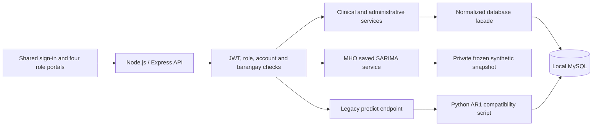

# Health-Intel project overview

> Local navigation31October2026: allfourportals expanded220px bydefault withbrand-hover/keyboard-focus desktopcollapsecontrol,80pxiconrailwithtooltips,andindependent visiblemobilemenu/drawer. Sharedportal-navigation.js/portal-responsive.css;46tests pass;freshbrowservisualcheckpending. Azureunchanged.

> Current LOCAL Predictions31October2026: versioned server/services/combined-sarima-demo.js with server/data/combined-sarima-5592 now supersedes the26October5500-case default.5592cases/3150monthly cells,10diseases/7barangays/45months. Same SARIMA policyA;70/70currentSARIMA,0fallback. Primary352/630=55.8730%,MAE1.147493/RMSE1.503777/MAPE52.238909%. Generated5500plus92ITR-derived entries;sourceconfirmationpending. Own selected metrics, old5500model/data intact for rollback. No model improvement claim;tests63passed;fresh renderedbrowsercheck unavailable. Azure unchanged. See LOCAL_COMBINED_SARIMA_20261031.md. Olderlocaldefault descriptions below are historical.

> Case Breakdown severity — 31 October 2026: panel includes overall recorded Mild/Monitored/High Risk totals and each disease's recorded severity counts. Unknown severity stays explicit; disease detail may be unavailable while its known severity is retained. Donut colors continue to represent disease share, separately from labeled severity badges. Existing BHW/MHO data scopes and backend contracts unchanged.

> BHW map scope — 31 October 2026: `/api/heatmap-data` constrains both case totals and disease-detail queries to the signed-in BHW's assigned barangay; invalid assignment fails closed. BHW Summary, Heat View and Case Breakdown therefore show only that barangay. MHO/Admin municipal aggregation is preserved. This supersedes earlier documentation/tests describing BHW access to other barangays' map totals. Basemap tiles can still show neighboring places; they do not expose other barangays' case totals or imply administrative boundaries.

> Local map UI — 31 October 2026: BHW/MHO Summary and dark Heat View have an optional Case Breakdown dialog. It aggregates the already returned active, non-archived disease details across the current map scope, showing a donut, total, counts and shares. Full table retains all categories; only chart categories beyond the leading six are grouped as Other. Missing/inconsistent disease detail is kept in the denominator and explicitly disclosed. This is recorded operational case distribution, not SARIMA data, predictions or outbreak risk. No new endpoint, DB query or authorization change. Isolated layout and arithmetic checks documented in CODEX_TASKS; Azure unchanged.

> **Current local forecasting update — 2026-10-26T20:43:39+08:00, CODEX-2:** LOCAL-5500 supersedes the historical Balanced integration descriptions below for the LOCAL Predictions route only. The active service is `server/services/lowcount-sarima-demo.js`, private data `server/data/lowcount-sarima-5500/`: 5,500 synthetic cases, 3,150 rows, Jan2023–Sep2026. Policy A numerical seasonal SARIMA primary with Seasonal Naive only on unavailable fits; 70/70 October2026 SARIMA forecasts, no current fallback. Each individual selection shows its own primary80/20 h1 metrics. New pooled reference350/630=55.56%, MAE1.142124/RMSE1.500087/MAPE52.289838%; old214,192cases/86.17% are archived evidence, not active results. Only6/70 current fits have supported annual-screen evidence;64 display the uncertainty warning. See [local integration report](LOCAL_LOWCOUNT_INTEGRATION_20261026.md) for actual changes, tests, limits and rollback. Azure was not updated. The original Balanced service/aggregate functionality and frozen evidence remain preserved. All earlier dated sections below are retained as historical context and do not override this update.

Reviewed25 October 2026 by **CODEX-1**, identified by the project owner. Active checkout: `C:\Users\User\Downloads\Final proj\proposal`; repository remote: https://github.com/irafayel23/Health-Intel1. Local source may be newer than GitHub. No fetch, remote comparison, commit, push or Azure inspection was performed for this documentation task.

Read [current handoff](CODEX_HANDOFF.md), [tasks](CODEX_TASKS.md), [shared change record](CODEX_CHANGELOG.md), and [root instructions](../AGENTS.md) each session. This overview supersedes prototype-era descriptions only where supported by the inspected source. It does not erase earlier reports.

## Purpose, scope and evidence levels

**HEALTH-INTEL: A Web-Based Community Health Surveillance with Predictive Analytics System** is a BSIT capstone for the Municipality of Murcia, Negros Occidental, Philippines. It supports authorized disease-case and consultation recording, review, monitoring, descriptive analytics, geographic summaries, sample reporting and synthetic monthly SARIMA forecasting. It assists planning; it does not provide independent diagnosis, treatment, outbreak declarations, emergency response, medicine distribution or hospital admission management.

Evidence labels used here:

- **Source-confirmed:** implementation inspected in this checkout; this alone is not a new end-to-end test.
- **Evidence-rechecked:** existing result/log files were read and, where stated, arithmetic or hashes independently checked during this documentation session. No model was retrained.
- **Historically reported:** dated earlier reports describe execution/deployment; not rerun or checked against the live external service in this session.
- **Proposed/deferred:** not implemented, not authorized merely by appearing here.

User-reported panel approval covers synthetic demonstration data. No panel document accepting the proposed forecasting tolerance was supplied. Genuine historical disease-data forecasting validation remains pending. Operational records, synthetic inputs and saved research evidence must stay distinct.

## Architecture and runtime

| Component | Actual implementation and boundary |
|---|---|
| Browser | Vanilla HTML/JavaScript: `index.html`, `bhw.html`, `mho.html`, `admin.html`, `superadmin.html`; role folders beneath `assets/js` and `assets/css`; shared auth, safe text, modal, visit, report and map helpers. No connected LGU/Mayor login role. Archived `legacy/` prototypes are not the active application. |
| API | `server/server.js` loads security/deployment configuration, a mysql2 pool wrapped by `createDatabaseFacade`, shared `/api` access control, and 12 route modules. Entrypoint defaults to port 3000. `/healthz` is liveness only. |
| Dependencies | `server/package.json` + lockfile: Express 5, mysql2, bcrypt, jsonwebtoken, Nodemailer, express-rate-limit, cors, dotenv, PDFKit, archiver + encrypted ZIP extension, csv-parse/stringify. Exact installed/locked versions below. No new dependency is needed for shared memory. |
| UI styling/libraries | Existing Tailwind utilities; local MHO/portal CSS compilation through `tools/styles` (Tailwind 3.4.17). Chart.js for operational charts, Leaflet for maps; shared accessibility/theme helpers. Existing CDN libraries, tiles and Firebase/Google flows can require Internet. A locally loaded saved forecast itself does not require a remote model service. |
| Python | `server/requirements.txt` pins pandas 3.0.1, numpy 2.3.5, statsmodels 0.15.0, mysql-connector-python 26.7.0 for the legacy compatibility bridge. Research SARIMA has its own frozen environment including pmdarima; do not assume installing server requirements reproduces research. `PYTHON_PATH`/project venv resolution remains in server entrypoint. |
| MySQL | Operational pool and schema-adaptation facade. Code uses parameterized queries/transactions in reviewed paths. Private database settings stay outside notes. No database connection or query was needed in this documentation session. |
| Mail/identity | Nodemailer SMTP for notifications/recovery; Firebase ID-token verification for Google-backed registration. These external flows are configuration-dependent and not revalidated here. |
| Deployment | `server/config/deployment-config.js`, `deploy/Caddyfile.example`, `deploy/health-intel.service.example`, private environment. Historical Azure architecture: HTTPS via Caddy to Node/Express on a VM with local MySQL. Current remote release/configuration not inspected. Saved SARIMA service explicitly refuses `NODE_ENV=production`; local integration is not an Azure release. |

Node **v24.22.1** / npm **11.19.1** were re-read from `C:\Program Files\nodejs` in this session. The lockfile uses v3. Locked direct versions include Express 5.3.0, mysql2 3.24.6, Nodemailer 10.2.1, bcrypt 6.0.0, jsonwebtoken 9.0.3, PDFKit 0.15.2. The security report records zero npm audit findings on23 October; no new registry audit was run for documentation, and zero findings would not establish overall security.

## Roles, authentication and permissions

All four roles use one login gateway; the authenticated role determines its portal. `server/middleware/access-control.js` is the route allowlist and source of truth, with additional service-level checks. Menu visibility alone is not authorization.

| Role | Implemented responsibilities | Boundaries |
|---|---|---|
| BHW | Assigned-barangay dashboard, new disease cases, linked consultation visits, resident histories, status/corrections/archive/restore, advised follow-up tracking, unlisted-condition reporting/clarification, resident death reports, maps and barangay reports. | Server enforces assignment, encoder identity and ownership of cases/residents; no MHO/SARIMA/Admin routes. |
| MHO | Municipal operational analytics, walk-in disease cases and visits, directory/history/follow-ups, disease review, resident death-status review/correction, heatmap, sample reports, local saved SARIMA Predictions. | SARIMA saved API is MHO-only; cannot manage Admin access or perform Superadmin backup. |
| Admin | Manage BHW/MHO account access; inspect/correct/archive/restore case records; add/archive/restore disease catalog entries; operational audit view. | Not routine consultation entry, MHO forecasting, or Admin approval. Some shared identity routes also admit Superadmin with target-role restrictions. |
| Superadmin | Admin-access management/history, technical health/record totals, master activity ledger and encrypted database backup. | Current portal is not a routine patient-entry interface; no restore/factory-reset endpoint. Not automatically granted MHO forecast access. |

Source-confirmed auth: bcrypt hashes, HS256 JWTs with 8-hour login expiry, approved/current database account checks, password-derived session versions, account session epochs, revoked-token checks and logout. Registration supports BHW/MHO/Admin pending approval, verifies Firebase identity and validates input. Login has IP/account throttling; password change and reset invalidate sessions. Reset codes are HMAC-protected, expire after15 minutes and are single-use/attempt-limited. Never put real login credentials in shared handoff records.

Deployment configuration supports only `TRUST_PROXY=false` or `loopback`, production HTTPS origin validation and dedicated local DB credentials. Development can otherwise default to all-interface binding/permissive CORS; current local launcher explicitly binds loopback. Do not generalize these reviewed controls into a complete security certification. See [security report](../server/security-reports/20261023/REPORT.md).

## Module inventory

All rows below are source-confirmed implementations unless marked otherwise; the documentation pass did not exercise their live workflows. Shared dependencies are the API auth layer, normalized facade/transactions, existing frontend helpers and MySQL unless noted.

| Module / purpose | Main files | Data / principal access | Implemented behavior; known limits |
|---|---|---|---|
| Sign-in, registration, recovery | `server/routes/auth-routes.js`; services `registration`, `firebase-verification`, `password-recovery`, `session-security`, `login-throttle`; `assets/js/index/`, shared `api-session.js` | Users/session/reset tables; public auth routes + authenticated self-service | Pending approval, Google identity verification, login/logout/password changes; live Google/SMTP not tested now. |
| Account governance | `server/routes/identity-routes.js`; services `account-status`, `account-directory`, `account-credentials`; Admin/Superadmin scripts | Users + audit; target-role enforcement | Approval/denial, undo denial, suspend/restore, Admin history. No new privileges inferred from UI. |
| New disease cases | `server/routes/case-routes.js`; `case-encoding`, `patient-validation`, `case-records`; `bhw-dialogs.js`, `mho-walkins.js`, shared `patient-visits.js` | Resident/case/location/catalog records; BHW/MHO | Validates identity, case dates, disease/reported condition, measurements, location, status/severity and conservative matching. Ambiguous identities are not automatically merged. |
| Consultation visits | `case-visits.js`, shared `patient-visits.js` | `case_visits` linked to case | New consultation vs admission/follow-up. Admissions/follow-ups add a visit to an existing case; they do not add another disease case or manage hospital admission. Measurements, referral, notes and return advice belong to visits. |
| Disease choices/catalog | `disease-registry.js`, `dashboard-data.js`, `assets/js/shared/encoding-controls.js`, `admin-registry.js` | Active/archived registry + scoped recorded counts; read BHW/MHO/Admin, manage Admin | Ranked top-ten suggestions with searchable full active catalog, not a ten-disease recording restriction. Archive preserves histories/name uniqueness. Forecast scope stays separate. |
| Unlisted condition review | routes `disease-review-routes.js`; services `disease-review`, `condition-review`; `mho-disease-review.js` | Case review state/source; MHO resolves, assigned BHW supplies requested clarification | Reported wording/source → Pending; link existing disease, add reviewed catalog condition, or request clarification. Transaction/version checks preserve original case and visits. A catalog addition does not enter SARIMA automatically. |
| Case maintenance | `case-corrections`, `case-lifecycle`, `record-archive`; BHW/Admin record scripts | Cases/visits + audit; barangay scope for BHW | Status updates, audited correction, archive/restore; historical source differences remain facts, not permission to overwrite resident identity. |
| Resident directory/history | `mho-patients` route/service; BHW resident routes and `bhw-residents.js`; `mho-patients.js` | Resident identities, linked and legacy cases, consultations | BHW assigned profiles/dossier; MHO municipal search/history. Identity matching is conservative and not a universal unique-person registry. |
| Follow-up tracking | route/service `followup-tracking`; shared `followup-tracking.js` | Latest `case_visits` advice; BHW/MHO | Due today/upcoming/past due, filters, pagination and return shortcut. Latest visit's plan replaces older advice; no automatic appointment scheduling/SMS, and past due does not prove a missed appointment. |
| Resident vital status | route/service `resident-vital`; shared `resident-vital.js`, MHO resident-vital script | `resident_death_reports`, `resident_vital_status`; BHW reports, MHO reviews/corrects/exports | Preserve history; optimistic correction guards; reject encounters after confirmed death date. Resident death is distinct from disease-case outcome and cause of death. |
| BHW monitoring | `dashboard-data`, `bhw-dashboard.js`, analytics routes | Scoped operational case/read views | Counts/trends of disease episodes, not number of consultations or proven population incidence. |
| Municipal analytics | `analytics-routes`, `mho-analytics.js` service/frontend, `age-groups.js` | Operational case records; MHO | Filters, KPIs, ranked conditions, age/barangay breakdown, year comparisons, time trends and case outcomes. Recorded-case descriptions, not validated disease rates. Separate sample-data support remains in service code; do not confuse it with SARIMA evidence. |
| GIS / heatmaps | `case-map-data`, shared `health-map.js`, `map-details.js`, `map-fullscreen.js`, `lazy-heatmap.js` | Barangay coordinates + recorded disease/severity totals; BHW/MHO/Admin API | Barangay-centroid proportional summaries/fullscreen detail, refresh and filters. No patient-point map, validated outbreak boundary or clinical disease-risk score. Tiles/library delivery may need network. |
| Daily/barangay reports | `daily-reports`, `daily-report`, `report-periods`, shared daily controls | Case dates + visit records; BHW own scope, MHO municipal | Today/selected-day PDFs, case vs consultation distinctions and recorded follow-up information. Exports can contain authorized identifiers; do not place sample live output in shared memory. |
| MHO sample reports | `mho-reports`, `report-data`, `report-export`, `mho-reports.js` frontend | Operational case aggregates/listings; MHO | FHSIS/PIDSR-style monthly/weekly samples and confirmed resident-status PDF. Not certification of official DOH forms or reporting completeness. |
| SARIMA Predictions | `balanced-sarima-routes`, `balanced-sarima-demo`, private snapshot; `mho-forecast.js` | Saved Balanced synthetic evidence; MHO local only | All88 selectors; dated graph/ranges, historical selected score/errors, saved estimated counts.66/70 individual future outputs,9/18 complete aggregates. No live fitting or operational-data forecast ingestion. |
| Forecast summary/advice | `mho-forecast.js`; frozen `narratives.py`, rules in snapshot | Same saved selected results, historical cutoff and frozen trigger IDs | Short calculated summary and rule-based follow-up requiring MHO review. No outbreak/diagnosis/treatment orders; unavailable totals do not get invented counts. |
| Audit/master ledger | `system-audit`, `case-audit`, identity routes; Admin/Superadmin scripts | Application audit rows with role-dependent filtering | Action/attribution/history metadata. Application-level audit, not cryptographically immutable or tamper-proof storage. |
| Health and recovery | identity health route; backup route/services `database-backup`, `backup-audit`; `deploy/backup-to-pc.ps1` | Superadmin technical metrics; authorized encrypted backup | SQL dump in encrypted ZIP, audit, tested restore fixtures in historical evidence. Scheduled backup-to-PC is a separate operational script/automation, not a portal restore button. Do not execute during docs setup. |

## Database architecture — source and dated migration evidence

The19 October normalization report describes **18 physical tables plus two read views** locally and on Azure. That is historical deployment evidence, not a new live schema inspection. The migration/facade source is present and consistent with the separation below; no patient rows or current DB metadata were queried for this task.

| Objects | Relationships and meaning |
|---|---|
| `barangays`, `users` | Barangay reference/centroids; users have assigned role/status, optional barangay and password/contact metadata. |
| `residents` | Current identity/address/birthdate. Known-birthdate ages and full names are derived; separately reported age/source-name facts survive when needed. |
| `health_cases` | Disease episode:12 physical fields per migration report—ID, resident/disease references, remarks, encoder, status, severity, case date, timestamps and archive metadata. |
| `case_visits` | Many consultations per case: date/time, encounter type, measurements, referral, severity/notes, return advice, encoder. Additional visits do not inflate episode counts. |
| `case_locations` | One case-time location per case; can differ from the resident's current address. |
| `case_condition_reviews` | One case's originally reported condition/source and MHO review state/note/reviewer/time. |
| `case_source_records` | Necessary unlinked/differing historical identity, original age/name or condition label; does not merge people or guess diagnoses. |
| `disease_registry` | Standardized disease reference with active/archive status; archive flag is generated from status in normalized schema. Name uniqueness includes archived entries. |
| `resident_death_reports`, `resident_vital_status` | Review history vs current person-level confirmed status; retain case and consultation histories. |
| `system_audit_logs`, `password_resets` | Role-filtered application audit and protected expiring reset-code records. Never log raw reset codes. |
| `login_attempt_limits`, `account_session_epochs`, `revoked_api_sessions` | Persistent login throttling and session invalidation/revocation support. |
| `normalization_migrations` | Version marker used to select normalized read/write behavior. |
| `predictions` | Historical schema/design table; not the storage backing the new saved SARIMA service. |
| `case_records`, `resident_records` | Read views exposing derived/legacy-compatible API fields. `server/services/normalized-schema.js` redirects supported reads and translates parameterized clinical writes transactionally. |

`normalize-clinical-schema.js` and [normalization report](NORMALIZATION_20261019.md) explain migration/recovery. Do not infer that every old physical field shown later in DATABASE.md is current; its opening normalization notice supersedes the older table listing. Do not claim a formal proof of 3NF from a diagram alone. Source-history facts deliberately preserved separately are not newly editable duplicate identity fields. Initializers/migration scripts may create tables when run; inspecting source must not invoke them.

## Important API map

Every path below is beneath `/api` except liveness. See each route file and the access-control allowlist for exact validation and role restrictions; this is a family index, not a new API contract.

| Route module | Important endpoints |
|---|---|
| Entry/auth | `GET /session`; `POST /login`, `/logout`, `/register`, `/get-next-id`, `/check-email`, `/forgot-password`, `/reset-password`, `/change-password`; public `GET /healthz` outside `/api`. |
| `identity-routes.js` | `/admin/{pending-users,active-users,denied-users,audit-logs}`; approve/deny/undo-deny/suspend/restore actions; `/superadmin/{pending-admins,approve-admin,health,users,audit-logs}`, `/superadmin/admins/:id/history`. |
| `case-routes.js` | `/bhw/context`, `/bhw/encoding-options`, `/bhw/puroks`, `/bhw/report-data`; `/patients`, `/patients/archived`, `/patients/:id/{visits,status,correction,archive,restore}`; `/residents`, `/residents/:id/dossier`; `/mho/walk-in-{options,cases,matches}`; `/admin/cases/:id`; `/heatmap-data`. |
| Disease review/registry | `/diseases`, `/diseases/archived`, `/diseases/:id/{archive,restore}`; `/mho/disease-reviews`, `/mho/disease-reviews/:id`; `/patients/:id/condition-clarification`. |
| Directory/follow-ups/vital | `/mho/patients`, `/mho/patients/{resident,legacy}/:id`; `/bhw/followups`, `/mho/followups`; `/residents/:id/death-report`, `/mho/resident-status`, `/mho/death-reports/:id/review`, `/mho/residents/:id/vital-status`. |
| Operational analytics | `/bhw-stats`, `/bhw-trend`, `/mho-stats`, `/analytics/demographics`; `/mho/{stats,kpi,trend,yoy,year-comparison,analytics-options,mortality,breakdown}`. |
| Reports/backup | `/bhw/reports/{today,daily}`, `/mho/reports/{today,daily,fhsis,pidsr,deceased-residents}`; `POST /superadmin/backup`. |
| Saved SARIMA | `GET /mho/sarima-demo/options`; `GET /mho/sarima-demo?disease=Cough&barangay=Salvacion&protocol=80_20&horizon=1`. Only `ALL` is an aggregate sentinel. Service supports secondary protocols/horizons even though current UI fixes primary h1. |
| Legacy compatibility | `/predict`, `/get-predictions` remain. `/predict` spawns `analytics.py`; the MHO saved SARIMA UI does not use it. No endpoint was removed during documentation. |

## SARIMA scope and data provenance

The user chooses the disease and barangay. The forecast estimates a monthly **case count**, not an unknown disease label, diagnosis or validated probability that at least one case occurs.

Exactly ten forecast categories: **Cough; URTI; Infection all types; ARI; Fever unknown origin; Hypertension; Influenza; Acute Gastroenteritis; Vertigo; All types of skin disease.** Exactly seven barangays: **Salvacion; Alegria; Blumentritt; Caliban; Cansilayan; Sta. Rosa; Minoyan.** Preserve spelling and mappings; operational catalog diseases outside this list remain recordable but are not forecast automatically.

The88 scopes are70 disease–barangay pairs,10 disease/all-seven aggregates,7 all-ten/barangay aggregates and1 all-ten/all-seven aggregate. Complete aggregates sum component forecasts and historical totals; their historical scores are calculated from complete aggregate targets, never an average of individual percentages. Missing components make the relevant complete total unavailable; they are not zeros.

Private application files: `server/data/balanced-sarima-demo/{SYNTHETIC_BALANCED_monthly.csv,snapshot.json,manifest.json,unavailable-causes.json}`. The CSV contains **3,150 monthly rows =70 histories ×45 months**, January 2023–September 2026, columns `Date,Barangay,Disease,Cases`. Seed **2026102503**, source SHA256 **eb6f5e97cbaeca41a775d41c43c66f7ae7d4c2d591e639be2639fd558bcf28d4**. These dimensions, exact names and source/import hashes were rechecked in this session.

Frozen research is outside the application at `C:\Users\User\.codex\visualizations\2026\09\26\01a0dc67-9eb2-7d12-988d-be95e09269e0\Health-Intel-SARIMA-Balanced-Demo`. Its source, generation/methodology, native diagnostics, target predictions, report, dashboard and verified ZIP must be retained.272 frozen-file hashes plus ZIP SHA256/CRC were checked again during shared-memory setup. ZIP SHA256: **269c2696c0136cd6562a50f39c3d1386afd48ec61c57790409bd6b56f7be1511**. The repository snapshot enables local display; it does not make every research environment/file portable to another PC. Both accounts on this PC must verify access before relying on external paths.

Balanced generation is a fictional seasonal teaching scenario: prespecified annual harmonics, disease/barangay baselines, trends, variable yearly amplitude/level, correlated Gaussian disturbances and mild temporary level fluctuations; rounded/floored nonnegative counts. It is not measured epidemiological incidence or a Poisson-calibrated disease process. The generator itself says annual structure is intentionally SARIMA-suitable. Easy, Moderate, challenging V1/V2/V3, adaptive and independent-comparison evidence are separate preserved experiments; never relabel or pool them with Balanced. This setup audited Balanced, not all earlier experiment methodologies.

## Frozen model and evaluation methodology

The research `engine.py`, `differencing.py`, `selection.py` and `policy.json` use **pmdarima ARIMA software to fit genuine seasonal SARIMA(p,d,q)(P,D,Q,12)**. Pmdarima is a library, not a competing model family. Engine code requires seasonal AR/MA terms (`P+Q>=1`) and verifies estimated seasonal parameters. It is not one identical order imposed on all 70 histories.

The optimized frozen menu has nine low-order templates. Differencing is decided using only the available training prefix. Annual harmonic/lag12 evidence is recorded as an evidence grade; the optimized method does not demand that every weak seasonal screen pass before fitting. Selection uses three matched training-only inner one-step targets, a 5% MAE proximity band and compatible effective-sample AICc. If no full inner comparison exists, an eligible compatible training-AICc selection is allowed with a weaker-evidence warning, not a substitute output model. Numerical eligibility, convergence, effective observations/parameter ratio, finite likelihood/parameters, roots, covariance and standardized-innovation Ljung–Box checks can reject candidates. No fallback ARIMA/SES/ML output is inserted in this SARIMA-only evidence.

AICc in source is `-2*llf + 2*k + 2*k*(k+1)/(n_effective-k-1)` with validity checks; a separate native pmdarima full-length version is recorded and crosschecked rather than silently conflated. Likelihood comparison groups include differencing/effective history/burn. Gaussian nominal 95% intervals are clipped at zero and omit model-selection uncertainty; they are not 95% accuracy and aggregate dependence-aware ranges are not implemented.

Primary evaluation is chronological **80/20**:36 initial months,9 one-month walk-forward targets per pair =630 attempts. Secondary **70/30** starts with31 months and14 one-step targets per pair =980 attempts. At each origin, fit/selection sees only earlier months; two-step tests are separate, with560 and 910 attempts respectively. Outer test observations are for evaluation, not candidate selection. These are inspected implementation rules and saved-result arithmetic; no fitting or new independent statistical certification occurred in this documentation pass.

## Metrics and verified saved results

For each produced target let actual=`y`, unrounded nonnegative prediction=`p`, absolute error=`|p-y|`, and proposed tolerance=`max(1,0.20*y)`. A hit has error no greater than tolerance, with existing numerical epsilon1e-12. With `A`attempts, `N`produced, `H`hits:

- Within proposed tolerance=`100*H/N` when N>0; otherwise unavailable. This is the UI's qualified historical accuracy label, not future probability.
- Passing/all attempts=`100*H/A`; availability=`100*N/A`. Missing results are not fabricated/scored as zero counts.
- MAE=`sum(abs(error))/N` cases; RMSE=`sqrt(sum(error²)/N)` cases.
- Positive-only MAPE=`mean(100*abs(error)/actual)` over produced targets with actual>0. Zero-actual counts are excluded only from MAPE and disclosed. MAPE is not within-tolerance and accuracy is not `100-MAPE`.

| Separate evaluation | Attempts | Produced | Hits | Within tolerance | MAE | RMSE | MAPE |
|---|---:|---:|---:|---:|---:|---:|---:|
| Primary80/20 h1 |630|600|517|86.17%|6.24|8.25|10.85%|
| Primary80/20 h2 |560|534|466|87.27%|6.84|9.14|11.09%|
| Secondary70/30 h1 |980|947|820|86.59%|6.42|8.52|10.92%|
| Secondary70/30 h2 |910|881|759|86.15%|6.81|9.11|11.64%|

All four rows were independently recomputed from the 70 individual saved target histories in this documentation session, not copied solely from the prompt. Primary h1:517/600×100=86.1667%;517/630=82.0635%passing/all attempts;600/630=95.2381%availability. Do not combine the two splits or choose whichever is higher.

Selection example **Cough/Salvacion**: primary h1=6/9=66.67%, MAE13.52, RMSE15.92, MAPE14.86%; h2=6/8=75%. Overall86.17% is not that pair's score. Saved future estimates: October 2026=69.6931883980 (about70), November 2026=65.4040190611 (about65). Native November interval42.5234–88.2846 is a nominal model range, not a guaranteed case count or future accuracy percentage.

## Current MHO local integration and UI

Source-confirmed: `balanced-sarima-demo.js` verifies the private manifest/source hashes on initial evidence load and caches the parsed snapshot. Its route layer and shared middleware require an approved MHO session; results use `Cache-Control:no-store`. Invalid labels, query arrays, unknown keys, protocols and horizons are rejected. The service refuses production mode. Browser Run Forecast fetches the saved selection; it never invokes Python, fits SARIMA, inserts data or reads operational cases for these estimates.

Current presentation incorporates the later25 October simplification and graph-label edits, not just the original integration guide's opening description:

- Large interactive graph: blue recorded synthetic history, purple past one-month test predictions, teal future estimates; shaded forecast period, individual model bands, hover/focus details, last24/full45-month history.
- Persistent graph labels show October/November estimated counts. On desktop, dated count/range cards and **Historical Forecast Accuracy / Past one-month predictions** appear in the right column; mobile stacks cards. Error metrics remain MAE/RMSE/MAPE with plain explanations.
- Main dashboard fixes primary80/20 one-month historical evaluation.70/30 and h2 comparisons are retained in private API/research evidence, not visible selectors.
- Small Synthetic demo data label remains. Large banner, visible REAL-WORLD VALIDATION PENDING wording, separate overall benchmark/availability cards and long calculation table were removed by earlier explicit user requests. Availability is still disclosed in the selected test counts. The long validation phrase remains true in backend provenance/research records. Do not restore warning banners as part of documentation-only work: the pasted project description's old UI checklist is not the current screen.
- Summary compares the saved main November estimate to September's recorded count, gives the two-month change and range. Recommendations use existing frozen trigger IDs with shorter display wording; synthetic advice is in the small note, date advice in the dated cards/footer. No recommendation claims an outbreak or orders an intervention.
- History ends September 2026. October is h1; November is h2 even though November is the next calendar month in the fixed25 October demo. Never insert predicted October as an observation. A separately authorized verified October update would be needed before a true h1 November fit.

Earlier guide: [LOCAL_SARIMA_INTEGRATION_20261025.md](LOCAL_SARIMA_INTEGRATION_20261025.md); read its appended simplification section and these current notes before relying on the historical opening paragraphs. Later graph/range evidence: external workspace `forecast-labels-20261025/REPORT.md` beneath the same visualization root.

## Known limitations and open work

| Finding | Evidence / consequence | Authorization state |
|---|---|---|
| Four future pairs unavailable | Infection all types/Cansilayan; ARI/Blumentritt; Influenza/Minoyan; Acute Gastroenteritis/Caliban. Native journals reject candidates for severe residual correlation or boundary roots. | Preserve. Method changes require a separate approved experiment, not a quick diagnostic bypass. |
| Aggregate coverage incomplete |66/70 individual future outputs and 9/18 complete aggregate scopes rechecked. All-ten/all-seven total unavailable. Some aggregate historical scores also unavailable. | No partial totals/averaged scores or alternative models as silent replacements. |
| No live SARIMA ingestion/retraining | Saved verified snapshot only; `/predict` is still a separate AR(1), three-step compatibility path that reads MySQL directly. | Future live forecasting is proposed, not authorized/implemented. Existing architectural intent to isolate Python from operational DB is not yet true for that legacy endpoint. |
| Validation and probability | Synthetic performance only; proposed tolerance lacks supplied panel acceptance; no validated occurrence-probability feature. | Human/panel decisions and separately scoped validation. Not prerequisites to documenting the working demo. |
| Forecast staleness | Fixed September cutoff and October/November outputs do not advance with the calendar. Gaussian/model-selection limitations remain. | Do not silently advance dates or label h2 as h1. |
| Identity/history uncertainty | Legacy unlinked/differing resident or disease source facts; duplicate-person certainty not guaranteed. | No automatic merge/backfill; needs authorized reviewed source reconciliation. |
| External workflows | SMTP inbox/TLS/provider delivery and Google/Firebase live registration not revalidated; map tiles/CDNs can depend on network. | Future designated test accounts and separate live verification. |
| Deployment mismatch risk | Local saved service is production-disabled; security/runtime/source can be newer than remote release. | No Azure sync/deployment authorized now. Remote release not inspected. |
| Old documentation | PROJECT_CONTEXT.md, old CHANGELOG/TODO and some opening architecture/database sections describe earlier code. | Use this overview/current source; preserve historical notes and update only with evidence. |
| Other unconfirmed bugs | No exhaustive current UI/security/load review in this docs task. Tests/logs do not prove absence of defects. | Do not invent bugs or mark all workflows newly tested. |

## Evidence, tests and preservation

Prior logs re-read: security maintenance227-pass suite and runtime check; local integration235-pass suite,352 scope/protocol/horizon browser states and5,632 assertions, prior mobile checks; simplification235-pass suite +88 scopes/792 display checks; graph-label follow-up8 targeted tests +5 representative browser scenarios. The corresponding JSON/logs and latest frontend hashes agree with inspected local files. These are **prior executions whose evidence was checked**, not tests rerun for documentation. Old full integration hashes precede later UI changes and must not be mistaken for current frontend hashes. No general application test suite, SMTP workflow, database migration, model run or Azure check was executed in this session.

Documentation-only validation saves an inventory of392 pre-existing Git-visible files,52 modified tracked files,112 untracked files, configuration hashes (no values), Git branch/HEAD/index state and protected research hashes. Session evidence lives at `C:\Users\User\.codex\visualizations\2026\09\26\01a0dc67-9eb2-7d12-988d-be95e09269e0\shared-memory-20261025`. Final preservation/Markdown checks are recorded there. No live database contents are needed to read these shared notes.

Safety: do not run seed/migration/import scripts, regenerate frozen CSVs, replace snapshots, change `.env`, audit credentials or run backup/deployment commands merely because older TODOs mention them. No secrets/patient identifiers belong in these documents. Code/data truth must be rechecked after either account changes the project.

## Current UI override — single-month redesign (UI-001,25October2026)

The latest owner brief supersedes the earlier two-month presentation above. Installed local MHO code now displays exactly the saved October2026 one-month forecast from the September cutoff. November output is retained in frozen/API evidence but is not plotted or displayed as a second result. The chart/performance grid is followed by full-width Forecast Summary, then Automated Recommendations. Main estimate is October; primary80/20 h1 historical metrics remain selection-specific, and aggregates use complete saved targets. Small synthetic and real-world-validation-pending labels remain visible per the latest brief; no technical split/horizon selectors or pooled benchmark cards are displayed.

New pure display helper assets/js/mho/sarima-presentation.js derives October comparisons/recommendations directly from h1 results. It deliberately does not reuse the frozen November-centered narrative. Recommendations reuse existing documented directional/availability/zero/evidence rule meanings for the displayed month, with no new medical-risk threshold. Sparse/failed outputs remain unavailable; zero is a valid available forecast; percent change from zero is undefined. Saved data/models/policy files are unchanged. Existing dependency-free SVG renderer is refined; no chart library/dependency added.

51 focused tests passed after final visual correction. Actual in-app browser checks covered all88 scopes with968 value assertions, desktop1440/mobile390/narrow320, graph click/keyboard controls, full45-month history, accuracy explanation/Escape, dark mode and real stopped-service clearing of stale forecasts. A320px popup clipping issue was corrected. Genuine screenshots and report are in mho-predictions-redesign-20261025 beneath the evidence root. Disposable synthetic QA data was removed with unchanged source fingerprint; normal localhost:3000 restored and viewport reset. This is responsive browser emulation, not physical-phone or full clinical-workflow certification. UI-001 Completed. Operational patient data/authentication/other portals/Azure/frozen model results unchanged.

## Latest follow-up — FORECAST-001 (25October2026)

Owner explicitly removed the Synthetic capstone demo / Real-world validation pending header badges after UI-001; the hidden status ID is retained and underlying provenance/validation truth is unchanged. All Diseases/All Barangays options remain. Isolated native-diagnostic review independently reproduced64 residual p-values and36 AICc values. One frozen17-template extension of the9-model menu recovered3of4 current fits without relaxing checks; Caliban gastroenteritis still fails and Influenza has weaker AICc-only selection evidence. The complete-coverage gate failed, so no full new backtest/promotion/Azure update was made. Original model/results/data/app coverage66/70 and9/18 aggregates remain. See sarima-coverage-review-20261025/REPORT.md in the evidence workspace.59 bounded native fits,31 focused UI/static tests passed; source/research preserved. Do not assign the original86.17% to the unvalidated challenger or interpret availability as accuracy.

## Current Azure release override — 2026-10-25T21:49:21+08:00

Azure release completed and verified on 25 October 2026. The public MHO Predictions page now matches the reviewed local dashboard, including removal of the two requested header labels. Exactly 12 runtime/evidence files were installed; original frozen Balanced results remain 66/70 future pairs and 9/18 complete aggregates. All/all remains unavailable. October 2026 is the sole displayed forecast from September history; Run Forecast loads saved evidence, without fitting or operational-patient queries. Historical scores remain selected-scope performance, not future occurrence probabilities.

The production service now has an explicit ENABLE_SARIMA_DEMO=true systemd opt-in; default production access remains disabled without that flag. MHO authorization, no-store responses, source-integrity checks and private-path protection remain. No credentials or private .env contents changed. No dependencies, schema, model, CSV, original research result or Azure networking/VM size changed.

Activation exposed a deployment defect: two newly created evidence directories inherited root-only 0700 access. Corrected only those two directories to root-owned 0750 with the existing healthintel service group. No public access was added. The first service-user CLI probe inherited the inaccessible waagent working directory; the corrected probe used the application server directory and passed. The application then loaded choices and forecasts normally. Failed probes and the original activation script are retained as evidence.

Verification: 44 focused local tests passed in DEPLOY-002; live API verification passed 1,006 assertions across all 88 scopes, including exact saved predictions/metrics, anonymous denial, non-MHO role denial, invalid choice/origin rejection and private-path denial. All four public frontend hashes match the local release. HTTPS health passes. Actual live browser checks covered Cough/Salvacion, Cough/all barangays, all diseases/Salvacion and incomplete all/all; desktop 1440 and mobile 390 responsive layouts were inspected, graph rendered, no mobile horizontal overflow, and genuine screenshots saved. This is browser emulation, not physical-device certification.

An encrypted recovery database ZIP was created on the VM; its SHA-256 and per-entry encryption flags passed. Private settings and 12 final file hashes passed. Clinical table fingerprints remained unchanged after verification; only revoked_api_sessions and system_audit_logs changed through designated test sign-in/sign-out. Recovery: /home/azureuser/azure-mho-dashboard-20261025. No Git staging, commit, push, reset or stash; security checkpoint retained. Remote runtime remains Node 24.21.0; local 24.22.1, with no runtime upgrade in this release.

Limits: original four missing pairs and incomplete aggregate forecasts remain; no exploratory lag2 results promoted, no live retraining, genuine disease-data validation remains pending and the proposed tolerance still needs panel acceptance. Existing broad 0777 modes observed on the remote application/server/services directories predate this release; they were not changed and warrant separately scoped deployment-permission hardening. Passing these checks is not a security certification.

See [verified release](AZURE_MHO_PREDICTIONS_20261025.md). This dated section supersedes older local-only / no-Azure / unconditional production-refusal descriptions for the explicitly authorized release.

## 2026-10-26T06:46:31+08:00 — CODEX-2 — UI-002 local individual-only Predictions

Local Predictions now offers exactly10 individual diseases and7 individual barangays,70 combinations. Removed All Diseases/All Barangays only from the Predictions dropdown population. Defaults remain Cough/Salvacion; Run Forecast uses the unchanged primary80/20 h1 saved results. Existing interactive graph, selected historical score/MAE/RMSE/MAPE, Summary, rule-based recommendations, dark mode and responsive styling retained. No split/horizon controls added. Four original future outputs remain unavailable with clearer individual statistical-check explanations and historical/next-month distinction; no forecast-dependent advice or invented point. No research challenger promoted.

Actual verification:42 focused Node tests passed/0failed/0skipped; actual in-app browser all70 combinations at1440desktop and390mobile,140 states/0mismatches. Compared estimates, selected scores/error metrics, history/forecast graph markers and interval presence, summaries, recommendation IDs/titles/actions, missing states and page overflow. Also320px popup bounds44–268/no overflow, dark/light values and graph colors,45-month full history, forecast-point inspection and genuine screenshots. Console errors:none. Browser harness used actual installed MHO markup/CSS/forecast scripts plus genuine frozen service results; it omitted auth/unrelated operational scripts in memory and never connected to MySQL. This verifies Predictions rendering, not a new authentication/clinical-workflow certification. Mock access-control regressions also passed.

Preservation: original frozen model/CSV/results/86.17% benchmark, installed backend88-scope aggregation service and every other module source/filter unchanged. All HTML IDs retained; mho.html changed only two script cache versions. Prior research/evidence hashes and original ZIP CRC verified. Git HEAD/index/security checkpoint unchanged; unrelated pre-existing work preserved. No dependencies, model fits, patient/DB writes or Azure operations. Azure retains its previous dropdowns because deployment is explicitly out of scope. Footer-removal request remains paused.

Modified:assets/js/mho/mho-forecast.js,assets/js/mho/sarima-presentation.js,mho.html,server/tests/mho-forecast-presentation.test.js,docs/CODEX_TASKS.md,docs/CODEX_HANDOFF.md,docs/CODEX_CHANGELOG.md,docs/PROJECT_OVERVIEW.md. Added repository files:none. Deleted:none. main/a65e804419c8e17b5963f9dbde9e7c443a39f2da. Evidence:C:\Users\User\.codex\visualizations\2026\09\26\01a0dc67-9eb2-7d12-988d-be95e09269e0\mho-individual-dropdowns-20261026/REPORT.md. Ownership released; no Azure deployment.

## Local map display update — 2026-10-30T21:53:50.3850147+08:00
BHW and MHO share a default Barangay Summary mode and optional Heat View through map-heat-view.js. Heat weights use recorded active totals at stored barangay centers; they are not case-level locations, population rates or outbreak predictions. Pinned local Leaflet.heat0.2.0 loads on demand; summary works without it. Existing API/database and Azure unchanged. See CODEX_CHANGELOG MAP-HEAT-VIEW and isolated report for actual verification scope.

Heat View presentation update (2026-10-30T22:19:00.4369262+08:00): charcoal basemap via tile-pane-only filter, barangay labels and intensity legend. Summary count markers/detail panels are available in Barangay Summary mode only. Shared BHW/MHO behavior; no new map service or Azure release.

## FINAL forecasting dataset and FORECAST-019 decision — 2026-10-31T22:49:22+08:00

The owner selected the combined 5,592-case dataset (3,150 monthly records, 70 histories, Jan2023–Sep2026) as the final PRIMARY dataset. Original 5,500-case evidence remains archived; do not revert automatically. Current local saved SARIMA baseline is352/630=55.87% with70/70 October outputs. The92 ITR-derived entries retain verification/coverage limitations; generated cases do not become real patient observations.

FORECAST-019 isolated partial-pooling research did not pass its consideration screen. No application or Azure integration occurred. It produced56/70 experimental October outputs and only small matched gains over training-mean Poisson. Numerical gradient stopping failures reduced coverage; zero/high/increase forecasting remains weak. See [FORECAST-019 report](FORECAST_019_PARTIAL_POOLING_REPORT.md) and its final-decision.json, which corrects initial unequal-target gate arithmetic without changing frozen models/results. Retain current SARIMA.

## FORECAST-020 solver repair decision — 2026-11-01T09:06:50+08:00

The isolated same-specification count-model solver repair restored all150 disease-prefix fits and70/70October outputs. Primary pooling373/630=59.21%,MAE1.092187/RMSE1.426061; secondary554/980=56.53%. Improvement over simple meanPoisson is small, higher-count/increase hit rates worse than SARIMA, and the unchanged review screen fails. Keep current local SARIMA352/630=55.87%,70/70October. No application/data/model/DB/Azure integration. All5592cases and prior research preserved; genuine validation remains pending. See [FORECAST-020 report](FORECAST_020_SOLVER_REPAIR_REPORT.md). No active fitting worker.
